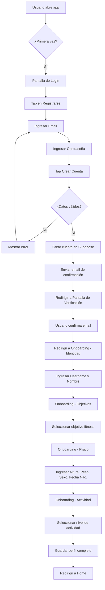
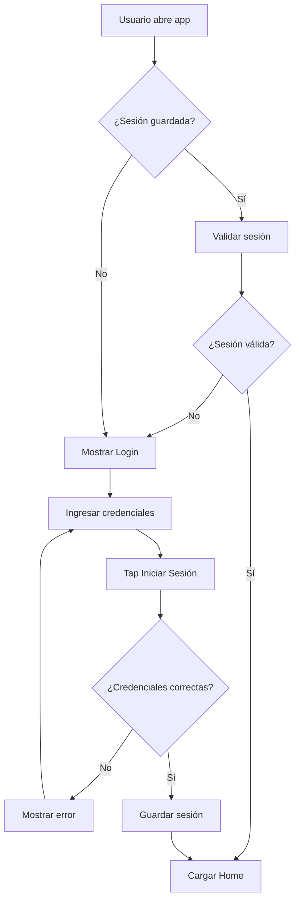
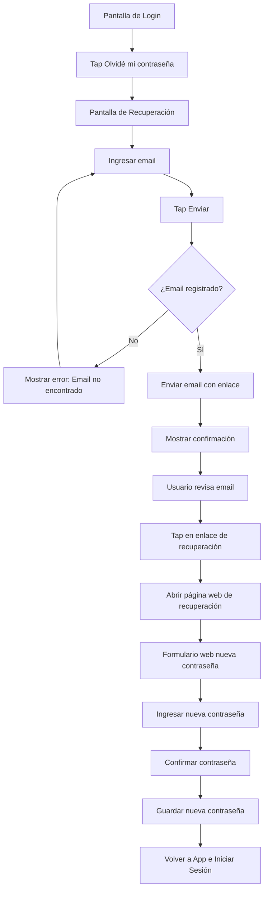
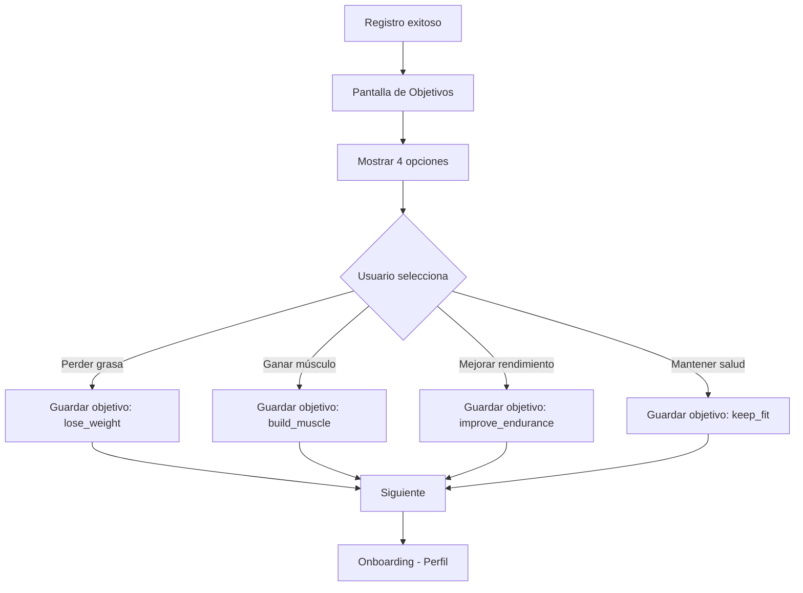
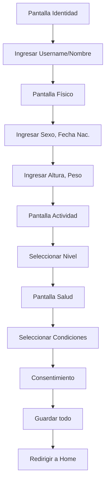
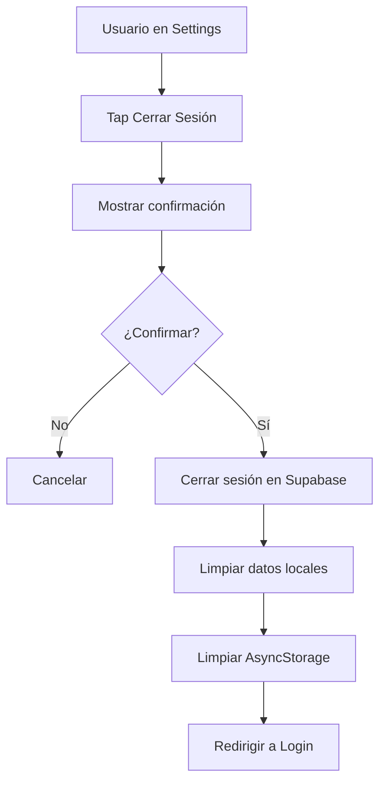

# Módulo de Autenticación - Documentación Funcional

## Índice

1. [Visión General](#visión-general)
2. [Flujos de Usuario](#flujos-de-usuario)
3. [Casos de Uso](#casos-de-uso)
4. [Reglas de Negocio](#reglas-de-negocio)
5. [Validaciones](#validaciones)
6. [Mensajes y Feedback](#mensajes-y-feedback)

---

## Visión General

El módulo de autenticación gestiona el acceso seguro a la aplicación Alzan Health. Permite a los usuarios:

- 🔐 **Iniciar sesión** con email y contraseña
- ✍️ **Registrarse** como nuevos usuarios
- 🔑 **Recuperar contraseña** olvidada
- 🎯 **Completar onboarding** paso a paso (Identidad, Objetivo, Físico, Actividad)
- 🚪 **Cerrar sesión** de forma segura

**Ubicación del Código**:

- Pantallas de Autenticación: `src/screens/auth/`
- Pantallas de Onboarding: `src/screens/onboarding/`
- Contexto de Autenticación: `src/context/AuthContext.tsx`
- Hooks de Onboarding: `src/hooks/useOnboarding.ts`

**Principio Fundamental**: Ningún usuario puede acceder a la aplicación sin estar autenticado. Todos los datos están protegidos por autenticación obligatoria.

---

## Flujos de Usuario

### Flujo 1: Registro de Nuevo Usuario



**Descripción**:

1. Usuario abre la app por primera vez
2. Ve la pantalla de login con opción "Registrarse"
3. Ingresa email y contraseña
4. Sistema valida formato y crea cuenta
5. Sistema crea cuenta y envía email
6. App muestra pantalla 'Verificar Email'
7. Usuario confirma desde su correo
8. **Completa onboarding en múltiples pasos**:
   - **Identidad**: Username único y nombre visible (`OnboardingIdentity`)
   - **Objetivo**: Seleccionar objetivo principal (`OnboardingGoal`)
   - **Físico**: Altura, peso, sexo, fecha nacimiento (`OnboardingPhysical`)
   - **Actividad**: Nivel de actividad física (`OnboardingActivity`)
   - **Salud**: Condiciones de salud (`OnboardingHealth`)
   - **Consentimiento**: Aceptación de términos (`OnboardingConsent`)
9. Accede a la aplicación principal

---

### Flujo 2: Login de Usuario Existente



**Descripción**:

1. Usuario abre la app
2. Si hay sesión guardada, se valida automáticamente
3. Si no hay sesión o es inválida, muestra pantalla de login
4. Usuario ingresa email y contraseña
5. Sistema valida credenciales
6. Si son correctas, guarda sesión y redirige a Home
7. Si son incorrectas, muestra mensaje de error

---

### Flujo 3: Recuperación de Contraseña



**Descripción**:

1. Usuario tap en "Olvidé mi contraseña"
2. Ingresa su email
3. Sistema envía email con enlace de recuperación
4. Usuario abre el enlace desde su email
5. **Se abre la página web** de recuperación (fuera de la app)
6. Usuario ingresa y confirma nueva contraseña en la web
7. Sistema actualiza contraseña
8. Usuario vuelve a la app e inicia sesión con la nueva contraseña

---

### Flujo 4: Onboarding - Selección de Objetivos



**Opciones Disponibles**:

- 🔥 **Perder grasa**: Para usuarios que quieren reducir peso
- 💪 **Ganar músculo**: Para usuarios que quieren aumentar masa muscular
- 🏃 **Mejorar rendimiento**: Para atletas que buscan mejor desempeño
- ❤️ **Mantener salud**: Para usuarios que buscan bienestar general

---

### Flujo 5: Onboarding - Perfil Detallado



**Datos Requeridos (repartidos en varias pantallas)**:

- **Identidad**: Username (único) y Display Name
- **Físico**:
  - Sexo: Masculino / Femenino
  - Fecha de nacimiento: Para calcular edad
  - Altura: En centímetros (100-250 cm)
  - Peso: En kilogramos (20-300 kg)
- **Actividad**:
  - Sedentario, Ligero, Moderado, Activo, Muy activo
- **Salud**: Lesiones o condiciones médicas relevantes
- **Consentimiento**: Aceptación legal

**Cálculos Automáticos**:

- IMC (Índice de Masa Corporal)
- TDEE estimado (Gasto Energético Diario Total)
- Rangos saludables de peso

---

### Flujo 6: Cerrar Sesión



**Descripción**:

1. Usuario navega a Settings
2. Tap en "Cerrar Sesión"
3. Sistema muestra confirmación
4. Si confirma:
   - Cierra sesión en servidor
   - Limpia todos los datos locales
   - Limpia caché de AsyncStorage
   - Redirige a pantalla de login

---

## Casos de Uso

### CU-A1: Iniciar Sesión con Email/Contraseña

**Actor**: Usuario registrado

**Precondiciones**:

- Usuario tiene cuenta creada
- Email está confirmado (opcional según configuración)

**Flujo Principal**:

1. Usuario abre la aplicación
2. Sistema muestra pantalla de login
3. Usuario ingresa email
4. Usuario ingresa contraseña
5. Usuario tap en "Iniciar Sesión"
6. Sistema valida credenciales
7. Sistema crea sesión
8. Sistema guarda sesión en AsyncStorage
9. Sistema redirige a Home

**Postcondiciones**:

- Usuario autenticado
- Sesión persistente guardada
- Acceso completo a la aplicación

**Flujos Alternativos**:

- **3a**: Email inválido → Mostrar error de formato
- **6a**: Credenciales incorrectas → Mostrar "Email o contraseña incorrectos"
- **6b**: Email no confirmado → Mostrar "Por favor confirma tu email"
- **6c**: Sin conexión → Mostrar "Sin conexión a internet"

---

### CU-A2: Registrarse

**Actor**: Usuario nuevo

**Precondiciones**:

- Usuario no tiene cuenta

**Flujo Principal**:

1. Usuario abre la aplicación
2. Sistema muestra pantalla de login
3. Usuario tap en "Registrarse"
4. Usuario ingresa email
5. Usuario ingresa contraseña
6. Usuario tap en "Crear Cuenta"
7. Sistema valida datos
8. Sistema crea cuenta en Supabase
9. Sistema envía email de confirmación
10. Sistema muestra mensaje de éxito
11. Sistema redirige a Onboarding

**Postcondiciones**:

- Cuenta creada
- Email de confirmación enviado
- Usuario en proceso de onboarding

**Flujos Alternativos**:

- **4a**: Email ya registrado → Mostrar "Este email ya está en uso"
- **5a**: Contraseña débil → Mostrar "La contraseña debe tener al menos 6 caracteres"
- **7a**: Formato de email inválido → Mostrar error

---

### CU-A3: Recuperar Contraseña

**Actor**: Usuario que olvidó su contraseña

**Precondiciones**:

- Usuario tiene cuenta registrada

**Flujo Principal**:

1. Usuario en pantalla de login
2. Usuario tap en "Olvidé mi contraseña"
3. Sistema muestra pantalla de recuperación
4. Usuario ingresa email
5. Usuario tap en "Enviar"
6. Sistema valida que email existe
7. Sistema envía email con enlace de recuperación
8. Sistema muestra "Revisa tu email"
9. Usuario abre email
10. Usuario tap en enlace
11. Se abre navegador web con formulario
12. Usuario ingresa nueva contraseña en la web
13. Usuario confirma nueva contraseña
14. Sistema actualiza contraseña
15. Usuario vuelve a la app e inicia sesión manualmente

**Postcondiciones**:

- Contraseña actualizada
- Usuario puede iniciar sesión con nueva contraseña

**Flujos Alternativos**:

- **6a**: Email no registrado → Mostrar "Email no encontrado"
- **13a**: Contraseñas no coinciden → Mostrar error
- **13b**: Contraseña débil → Mostrar requisitos

---

### CU-A4: Completar Onboarding - Objetivos

**Actor**: Usuario recién registrado

**Precondiciones**:

- Usuario acaba de crear cuenta
- Usuario no ha completado onboarding

**Flujo Principal**:

1. Sistema muestra pantalla de objetivos
2. Sistema presenta 4 opciones de objetivos
3. Usuario selecciona un objetivo
4. Usuario tap en "Siguiente"
5. Sistema guarda objetivo en `user_preferences`
6. Sistema redirige a pantalla de perfil

**Postcondiciones**:

- Objetivo guardado
- Usuario avanza a siguiente paso de onboarding

**Flujos Alternativos**:

- **3a**: Usuario no selecciona nada → Botón "Siguiente" deshabilitado

---

### CU-A5: Completar Onboarding - Perfil

**Actor**: Usuario recién registrado

**Precondiciones**:

- Usuario completó selección de objetivos

**Flujo Principal**:

1. Sistema muestra formulario de perfil
2. Usuario selecciona sexo
3. Usuario selecciona fecha de nacimiento
4. Usuario ingresa altura
5. Usuario ingresa peso
6. Usuario selecciona nivel de actividad
7. Usuario tap en "Completar"
8. Sistema valida datos
9. Sistema guarda perfil en `profiles`
10. Sistema calcula métricas iniciales (IMC, TDEE)
11. Sistema marca onboarding como completado
12. Sistema redirige a Home
13. Sistema muestra mensaje de bienvenida

**Postcondiciones**:

- Perfil completo guardado
- Métricas iniciales calculadas
- Onboarding completado
- Usuario tiene acceso completo a la app

**Flujos Alternativos**:

- **8a**: Altura fuera de rango (100-250 cm) → Mostrar error
- **8b**: Peso fuera de rango (20-300 kg) → Mostrar error
- **8c**: Edad menor de 13 años → Mostrar error de edad mínima

---

### CU-A6: Cerrar Sesión

**Actor**: Usuario autenticado

**Precondiciones**:

- Usuario tiene sesión activa

**Flujo Principal**:

1. Usuario navega a Settings
2. Usuario tap en "Cerrar Sesión"
3. Sistema muestra diálogo de confirmación
4. Usuario tap en "Sí, cerrar sesión"
5. Sistema cierra sesión en Supabase
6. Sistema limpia AsyncStorage
7. Sistema limpia estado de la aplicación
8. Sistema redirige a pantalla de login

**Postcondiciones**:

- Sesión cerrada
- Datos locales eliminados
- Usuario no autenticado

**Flujos Alternativos**:

- **4a**: Usuario tap en "Cancelar" → Volver a Settings

---

## Reglas de Negocio

### RN-A1: Acceso Obligatorio con Autenticación

- **Regla**: Ningún usuario puede acceder a ninguna funcionalidad de la aplicación sin estar autenticado
- **Excepción**: Pantallas de login, registro y recuperación de contraseña

### RN-A2: Confirmación de Email

- **Regla**: Los usuarios deben confirmar su email antes de poder iniciar sesión (configurable)
- **Implementación**: Supabase envía email automáticamente al registrarse

### RN-A3: Onboarding Obligatorio

- **Regla**: Los nuevos usuarios deben completar el onboarding antes de acceder a la app principal
- **Pasos Obligatorios**:
  1. Selección de objetivo
  2. Completar perfil personal

### RN-A4: Edad Mínima

- **Regla**: Los usuarios deben tener al menos 13 años para usar la aplicación
- **Validación**: Calculada desde fecha de nacimiento

### RN-A5: Persistencia de Sesión

- **Regla**: La sesión debe persistir entre cierres de la aplicación
- **Duración**: 30 días (configurable en Supabase)
- **Renovación**: Automática mientras el usuario use la app

### RN-A6: Seguridad de Contraseñas

- **Regla**: Las contraseñas deben cumplir requisitos mínimos de seguridad
- **Requisitos**:
  - Mínimo 6 caracteres (configurable)
  - No puede ser igual al email

### RN-A7: Limpieza al Cerrar Sesión

- **Regla**: Al cerrar sesión, todos los datos locales deben eliminarse
- **Incluye**:
  - AsyncStorage completo
  - Caché de React Query
  - Estado de la aplicación

---

## Validaciones

### Validaciones de Email

#### Formato Válido

```
✅ user@example.com
✅ user.name@example.co.uk
✅ user+tag@example.com
❌ userexample.com
❌ @example.com
❌ user@
```

#### Email Único

- El email no puede estar ya registrado en el sistema
- Validación en servidor (Supabase)

---

### Validaciones de Contraseña

#### Requisitos Mínimos

- **Longitud**: Mínimo 6 caracteres
- **Caracteres permitidos**: Cualquier carácter UTF-8

#### Confirmación

- En registro y cambio de contraseña, se debe confirmar ingresando dos veces
- Ambas contraseñas deben coincidir exactamente

---

### Validaciones de Perfil

#### Altura

- **Rango**: 100 - 250 cm
- **Tipo**: Número decimal
- **Mensaje de error**: "La altura debe estar entre 100 y 250 cm"

#### Peso

- **Rango**: 20 - 300 kg
- **Tipo**: Número decimal
- **Mensaje de error**: "El peso debe estar entre 20 y 300 kg"

#### Fecha de Nacimiento

- **Edad mínima**: 13 años
- **Edad máxima**: 120 años
- **Formato**: YYYY-MM-DD
- **Mensaje de error**: "Debes tener al menos 13 años para usar la aplicación"

#### Sexo

- **Opciones**: Masculino, Femenino
- **Obligatorio**: Sí

#### Nivel de Actividad

- **Opciones**: Sedentario, Ligero, Moderado, Activo, Muy activo
- **Obligatorio**: Sí

---

## Mensajes y Feedback

### Mensajes de Éxito

#### Registro Exitoso

```
✅ ¡Cuenta creada con éxito!
   Revisa tu email para confirmar tu cuenta.
```

#### Login Exitoso

```
✅ ¡Bienvenido de vuelta!
```

#### Recuperación de Contraseña Enviada

```
✅ Email enviado
   Revisa tu bandeja de entrada para restablecer tu contraseña.
```

#### Contraseña Actualizada

```
✅ Contraseña actualizada
   Ya puedes iniciar sesión con tu nueva contraseña.
```

#### Perfil Completado

```
✅ ¡Perfil completado!
   Bienvenido a Alzan Health.
```

---

### Mensajes de Error

#### Credenciales Incorrectas

```
❌ Email o contraseña incorrectos
   Por favor verifica tus datos e intenta de nuevo.
```

#### Email Ya Registrado

```
❌ Este email ya está en uso
   ¿Olvidaste tu contraseña? Puedes recuperarla aquí.
```

#### Email No Confirmado

```
⚠️ Email no confirmado
   Por favor confirma tu email antes de iniciar sesión.
   ¿No recibiste el email? Reenviar
```

#### Formato de Email Inválido

```
❌ Email inválido
   Por favor ingresa un email válido.
```

#### Contraseña Débil

```
❌ Contraseña demasiado corta
   La contraseña debe tener al menos 6 caracteres.
```

#### Contraseñas No Coinciden

```
❌ Las contraseñas no coinciden
   Por favor verifica que ambas contraseñas sean iguales.
```

#### Sin Conexión

```
❌ Sin conexión a internet
   Por favor verifica tu conexión e intenta de nuevo.
```

#### Error del Servidor

```
❌ Error del servidor
   Algo salió mal. Por favor intenta de nuevo más tarde.
```

#### Sesión Expirada

```
⚠️ Tu sesión ha expirado
   Por favor inicia sesión de nuevo.
```

---

## Estados de la Interfaz

### Estado de Carga (Loading)

- **Cuándo**: Durante validación de credenciales, creación de cuenta, envío de emails
- **UI**: Botón deshabilitado con spinner
- **Texto**: "Iniciando sesión...", "Creando cuenta...", "Enviando..."

### Estado Vacío

- **Cuándo**: Primera vez que usuario abre la app
- **UI**: Pantalla de login limpia con logo de Alzan Health

### Estado de Error

- **Cuándo**: Después de validación fallida
- **UI**: Mensaje de error en rojo debajo del campo correspondiente
- **Duración**: Permanece hasta que usuario corrija el error

### Estado de Éxito

- **Cuándo**: Después de acción exitosa
- **UI**: Alert nativo o toast con mensaje de confirmación
- **Duración**: 2-3 segundos antes de redirigir

---

## Accesibilidad

### Navegación por Teclado

- Tab entre campos de formulario
- Enter para enviar formulario
- Escape para cerrar modales

### Lectores de Pantalla

- Todos los campos tienen labels descriptivos
- Mensajes de error son anunciados
- Botones tienen texto descriptivo

### Contraste de Colores

- Textos cumplen WCAG AA (ratio 4.5:1)
- Errores en rojo con suficiente contraste
- Botones primarios con alto contraste

---

## Mejoras Futuras

### Funcionalidades Planificadas

- [ ] Login con Google (OAuth real)
- [ ] Login con Apple (OAuth real)
- [ ] Autenticación biométrica (Face ID / Touch ID)
- [ ] Autenticación de dos factores (2FA)
- [ ] Login con número de teléfono (SMS)
- [ ] Opción "Recordar en este dispositivo"
- [ ] Gestión de múltiples dispositivos
- [ ] Notificación de login desde nuevo dispositivo
