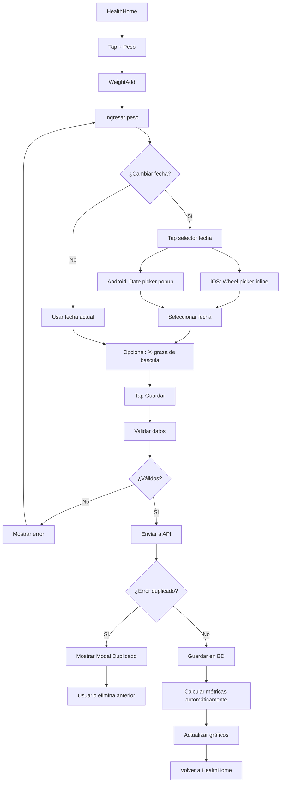
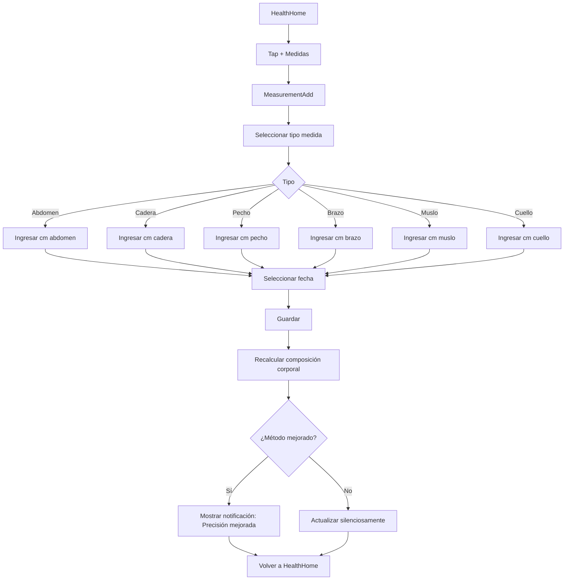
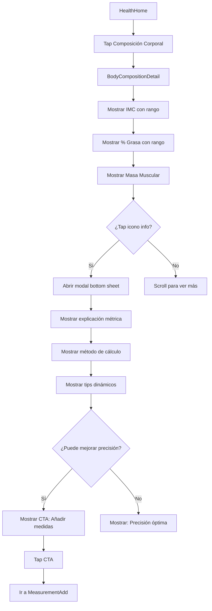
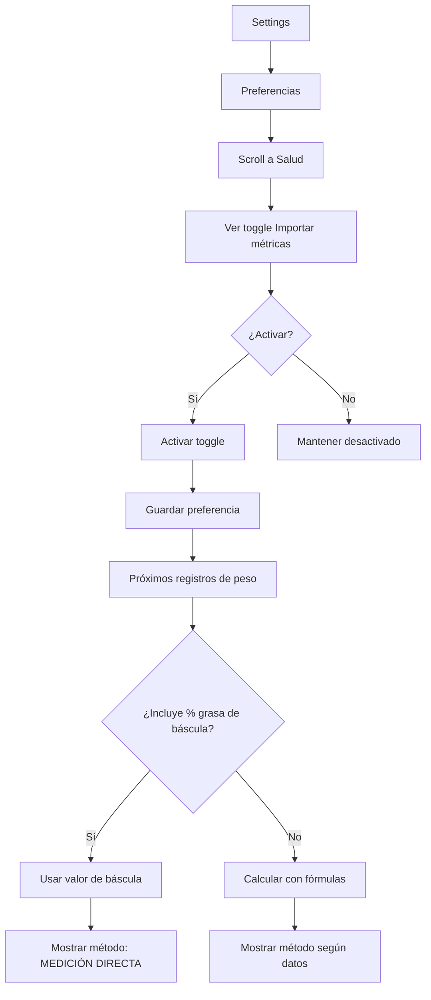

# Módulo de Salud - Documentación Funcional

## Visión General

El módulo de salud permite rastrear métricas corporales y calcular composición corporal automáticamente:

- ⚖️ **Peso**: Registro con tendencias y gráficos
- 📏 **Medidas**: Abdomen, cadera, pecho, brazo, muslo, cuello
- 📊 **Composición**: IMC, % grasa, masa muscular (calculados automáticamente)
- 📈 **Gráficos**: Tendencias interactivas con filtros de tiempo
- 🔄 **Importación**: Opción para usar datos de básculas inteligentes

**Ubicación del Código**:

- Módulo Principal: `src/modules/health/`
- Pantallas: `src/modules/health/screens/`
- Lógica de Negocio: `src/modules/health/hooks/useHealthInsights.ts`
- Algoritmos: `src/modules/health/algorithms/bodyComposition.ts`

---

## Flujos de Usuario

### Flujo 1: Registrar Peso



**Cálculos Automáticos al Guardar**:

1. IMC = peso / altura²
2. % Grasa corporal (según datos disponibles)
3. Masa muscular (según datos disponibles)
4. Tendencia vs registro anterior

---

### Flujo 2: Registrar Medidas Corporales



**Mejoras de Precisión**:

- Solo peso + altura → Deurenberg (básico)
- - Abdomen → WHtR (mejor)
- - Cadera → BAI + WHtR (muy bueno)
- - Pecho + Brazo + Muslo → Antropometría completa (óptimo)

---

### Flujo 3: Ver Composición Corporal



**Modal de Información**:

- **Diseño**: Bottom sheet con slide-up
- **Color temático**: Azul (IMC), Verde (Grasa), Morado (Músculo)
- **Contenido**:
  - Explicación de la métrica
  - Fórmula de cálculo con valores reales
  - Método usado (ej: "DEURENBERG", "BAI + WHtR")
  - Tips para mejorar precisión

---

### Flujo 4: Activar Importación de Métricas



**Lógica de Priorización**:

1. **Si toggle activado** Y hay `bodyfat_percent` → Usar ese valor
2. **Si no** → Calcular con mejor método disponible

---

## Casos de Uso

### CU-H1: Registrar Peso

**Actor**: Usuario

**Precondiciones**: Usuario autenticado

**Flujo Principal**:

1. Usuario tap en "+ Peso"
2. Ingresa peso en kg
3. Opcionalmente cambia fecha
4. Opcionalmente ingresa % grasa de báscula
5. Tap en "Guardar"
6. Sistema valida peso (20-300 kg)
7. Sistema guarda en `weight_logs`
8. Sistema recalcula:
   - IMC
   - % Grasa corporal
   - Masa muscular
9. Sistema actualiza gráficos
10. Muestra confirmación

**Postcondiciones**:

- Peso guardado
- Métricas actualizadas
- Gráficos refrescados

**Flujos Alternativos**:

- **6a**: Peso fuera de rango → Error "El peso debe estar entre 20 y 300 kg"
- **6b**: Fecha futura → Error "La fecha no puede ser futura"

---

### CU-H2: Ver Composición Corporal Detallada

**Actor**: Usuario

**Precondiciones**:

- Usuario tiene al menos un registro de peso
- Usuario tiene altura en perfil

**Flujo Principal**:

1. Usuario tap en "Composición Corporal"
2. Sistema calcula:
   - IMC con categoría OMS
   - % Grasa con método óptimo
   - Masa muscular con método óptimo
3. Sistema muestra tarjetas con:
   - Valor actual
   - Delta vs anterior
   - Barra de rango con posición
   - Badge de categoría
4. Usuario tap en icono info
5. Sistema abre modal bottom sheet
6. Muestra:
   - Explicación de métrica
   - Método de cálculo usado
   - Fórmula con valores reales
   - Tips para mejorar precisión
7. Usuario cierra modal

**Postcondiciones**: Usuario entiende sus métricas

---

### CU-H3: Mejorar Precisión de Cálculos

**Actor**: Usuario

**Precondiciones**: Usuario usa método básico (Deurenberg)

**Flujo Principal**:

1. Usuario ve modal de % Grasa
2. Sistema muestra: "Método: DEURENBERG"
3. Sistema muestra tip: "Mejora la precisión: Añade Abdomen y Cadera"
4. Usuario tap en CTA
5. Sistema navega a MeasurementAdd
6. Usuario registra abdomen
7. Usuario registra cadera
8. Sistema recalcula con método "BAI + WHtR"
9. Sistema muestra notificación: "Precisión mejorada"
10. Próxima vez que vea modal: "Método: BAI + WHtR"

**Postcondiciones**:

- Medidas guardadas
- Método mejorado
- % Grasa más preciso

---

## Reglas de Negocio

### RN-H1: Cálculo Automático de Métricas

- **Regla**: IMC, % grasa y masa muscular se calculan automáticamente
- **Trigger**: Al guardar peso o medidas
- **Método**: Mejor disponible según datos

### RN-H2: Priorización de Métodos

**% Grasa Corporal** (de menos a más preciso):

1. Deurenberg (solo peso, altura, edad, sexo)
2. BAI (+ cadera)
3. WHtR (+ abdomen)
4. BAI + WHtR (+ abdomen + cadera)
5. Antropometría completa (+ pecho + brazo + muslo)
6. Medición directa (báscula, si import_health_metrics activado)

**Masa Muscular**:

1. Al-Gindan (solo peso, altura, edad, sexo)
2. CMC Avanzado (+ pecho + brazo + muslo)

### RN-H3: Preferencia de Importación

- **Regla**: Si `import_health_metrics = true` Y hay `bodyfat_percent`, usar ese valor
- **Aplicación**: Solo para % grasa corporal
- **Visualización**: Modal muestra "MEDICIÓN DIRECTA"

### RN-H4: Rangos Dinámicos

- **Regla**: Rangos de % grasa y masa muscular varían por edad y sexo
- **Ejemplo**: Mujer 25 años vs Hombre 50 años tienen rangos diferentes
- **Actualización**: Automática al cambiar edad o sexo en perfil

### RN-H5: Validaciones de Datos

**Peso**:

- Mínimo: 20 kg
- Máximo: 300 kg

**% Grasa (opcional)**:

- Mínimo: 3%
- Máximo: 60%

**Medidas Corporales**:

- Mínimo: 10 cm
- Máximo: 200 cm

**Fecha**:

- No puede ser futura
- Puede ser pasada (para registros históricos)

---

## Validaciones

### Peso

```
✅ 70.5 kg
✅ 85 kg
❌ 15 kg (muy bajo)
❌ 350 kg (muy alto)
❌ -5 kg (negativo)
```

### Medidas

```
✅ 85.5 cm (cintura)
✅ 100 cm (cadera)
❌ 5 cm (muy bajo)
❌ 250 cm (muy alto)
```

### Fecha

```
✅ Hoy
✅ Ayer
✅ Hace 1 mes
❌ Mañana
❌ Próxima semana
```

---

## Mensajes y Feedback

### Mensajes de Éxito

```
✅ Peso registrado
   Tu composición corporal ha sido actualizada.
```

```
✅ Medidas guardadas
   Precisión de cálculo mejorada.
```

```
✅ Precisión óptima
   Tus medidas están completas para el cálculo más exacto.
```

### Mensajes de Error

```
❌ Peso inválido
   El peso debe estar entre 20 y 300 kg.
```

```
❌ Fecha inválida
   La fecha no puede ser futura.
```

```
❌ Medida inválida
   La medida debe estar entre 10 y 200 cm.
```

### Notificaciones de Mejora

```
🎯 Precisión mejorada
   Ahora usamos el método BAI + WHtR para mayor exactitud.
```

```
⭐ Precisión óptima alcanzada
   Con todas tus medidas, obtienes el cálculo más preciso.
```

---

## Estados de la Interfaz

### Estado de Carga

- Skeleton loaders para tarjetas
- Shimmer effect en gráficos

### Estado Vacío

**Sin Registros de Peso**:

```
⚖️ Sin registros
Registra tu primer peso para comenzar.
[+ Registrar Peso]
```

**Sin Medidas**:

```
📏 Sin medidas
Añade medidas para mejorar la precisión.
[+ Añadir Medidas]
```

### Estado con Datos Básicos

- Muestra IMC y % grasa con Deurenberg
- Banner: "Mejora la precisión añadiendo medidas"

### Estado con Datos Completos

- Muestra todas las métricas
- Badge: "Precisión óptima"
- Sin banners de mejora

---

## Mejoras Futuras

- [ ] Integración con Apple Health / Google Fit
- [ ] Fotos de progreso con comparación
- [ ] Predicción de tendencia
- [ ] Alertas de cambios significativos
- [ ] Exportar informe PDF
- [ ] Sincronización con básculas Bluetooth
- [ ] Análisis de composición por segmentos corporales
- [ ] Recomendaciones personalizadas
