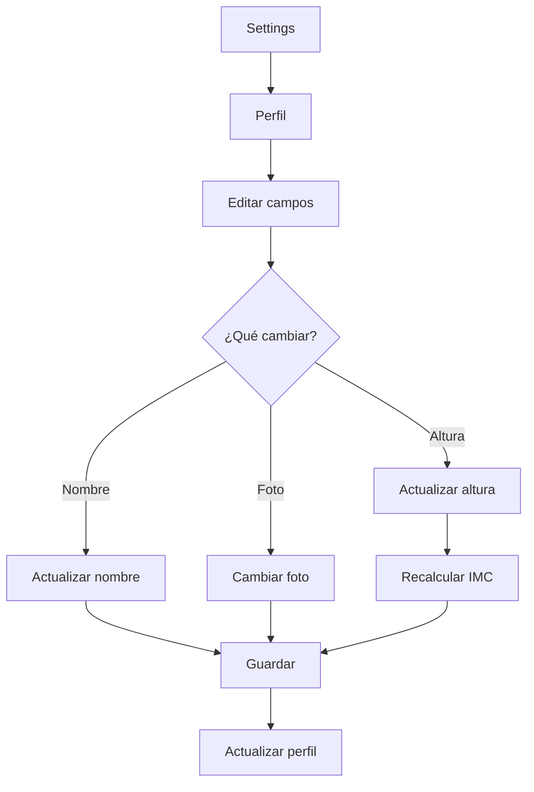
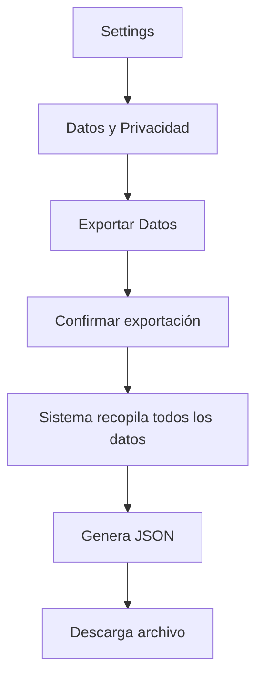
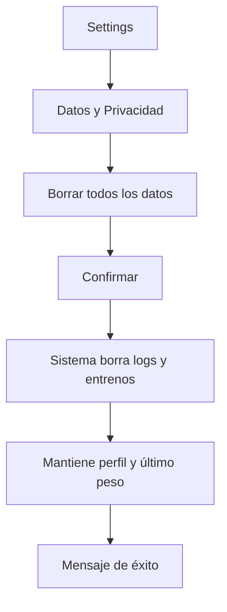

# Módulo de Configuración - Documentación Funcional

## Visión General

Gestión de configuración personal y privacidad:

- 👤 **Perfil**: Datos personales
- ⚙️ **Preferencias**: Unidades, notificaciones, importación de métricas
- 🎯 **Objetivos**: Metas de fitness
- 🔗 **Apps Conectadas**: Integraciones externas
- 📦 **Datos**: Exportar/eliminar (GDPR)

**Ubicación del Código**:

- Pantallas: `src/screens/settings/`
- Perfil: `src/screens/settings/ProfileSettingsScreen.tsx`
- Exportación: `src/screens/settings/DataExportScreen.tsx`
- Privacidad/Borrado: `src/screens/settings/PrivacyDataScreen.tsx`
- Entrenamiento: `src/screens/training/TrainingSettingsScreen.tsx`
- Nutrición: `src/screens/nutrition/NutritionSettingsScreen.tsx`

---

## Flujos Principales

### Flujo 2: Editar Perfil



---

### Flujo 3: Exportar Datos (GDPR)



### Flujo 4: Resetear Datos (Soft Delete)



```

---

## Casos de Uso


### CU-S2: Exportar Datos

**Flujo**:
1. Usuario va a Settings > Datos y Privacidad
2. Tap "Exportar mis datos"
3. Sistema genera JSON con:
   - Perfil
   - Peso y medidas
   - Entrenamientos
   - Nutrición
4. Usuario descarga archivo

### CU-S3: Resetear Datos
**Flujo**:
1. Usuario va a Settings > Privacidad
2. Tap "Borrar todos los datos"
3. Confirma acción
4. Sistema elimina historial de ejercicios, comidas, medidas
5. **Sistema mantiene**: Perfil usuario y último registro de peso

### CU-S4: Eliminar Cuenta

**Flujo**:
1. Usuario va a Settings > Eliminar Cuenta
2. Lee advertencia
3. Ingresa contraseña para confirmar
4. Sistema elimina:
   - Usuario de auth
   - Todos los datos asociados
5. Cierra sesión

---

## Reglas de Negocio


### RN-S2: GDPR Compliance
- **Portabilidad**: Usuario puede exportar todos sus datos
- **Derecho al olvido**: Usuario puede eliminar cuenta completamente
- **Consentimiento**: Explícito para datos de salud

### RN-S3: Validación de Cambios
- **Altura**: 100-250 cm
- **Peso objetivo**: 20-300 kg
- **Calorías objetivo**: 800-5000 kcal

---

## Mejoras Futuras
- [ ] Autenticación de dos factores
- [ ] Gestión de sesiones activas
- [ ] Backup automático
- [ ] Importar datos de otras apps
```
