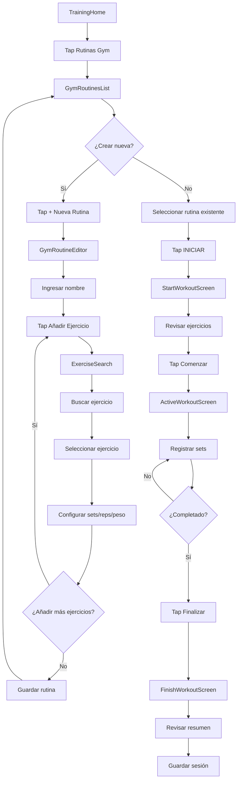
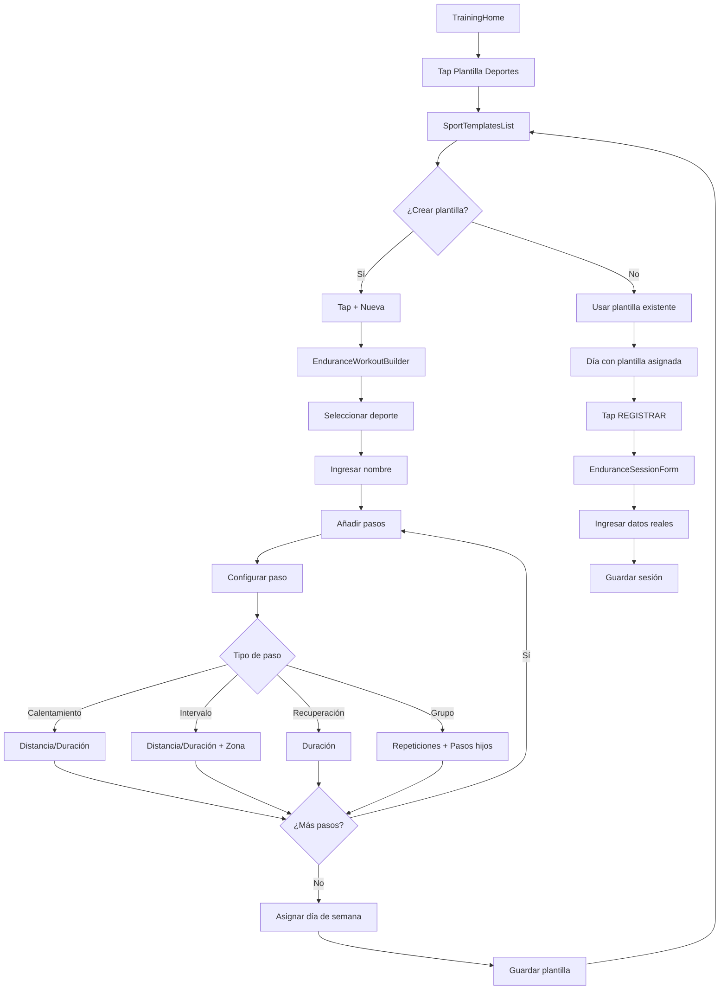
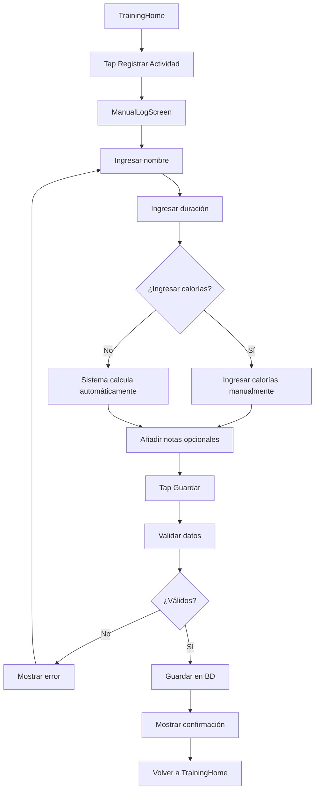
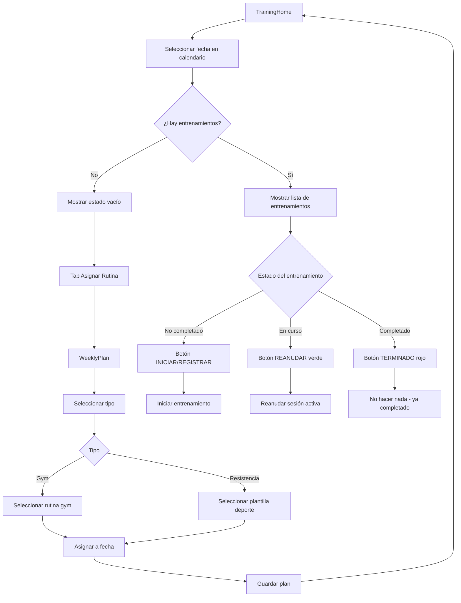
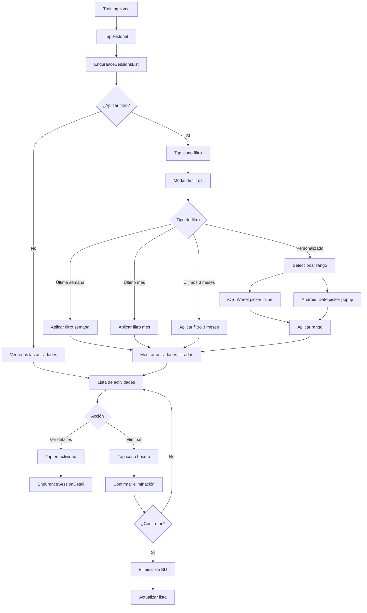
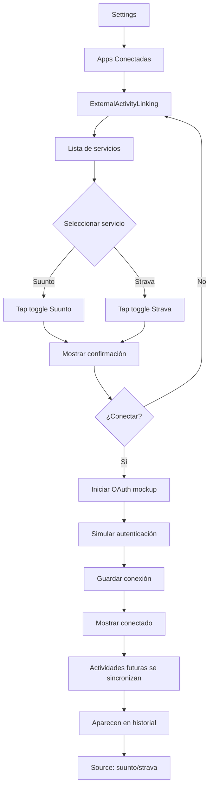

# Módulo de Entrenamiento - Documentación Funcional

## Índice

1. [Visión General](#visión-general)
2. [Flujos de Usuario](#flujos-de-usuario)
3. [Casos de Uso](#casos-de-uso)
4. [Reglas de Negocio](#reglas-de-negocio)
5. [Validaciones](#validaciones)
6. [Mensajes y Feedback](#mensajes-y-feedback)

---

## Visión General

El módulo de entrenamiento permite a los usuarios:

- 🏋️ **Crear y ejecutar rutinas de gimnasio** con seguimiento en tiempo real
- 🏃 **Registrar actividades de resistencia** (running, cycling, swimming, etc.)
- 📅 **Planificar entrenamientos** en un calendario semanal
- 📊 **Ver historial** de todas las actividades realizadas
- 🔗 **Conectar apps externas** (Suunto, Strava) para sincronización automática
- ⚡ **Registro rápido** de actividades manuales

**Ubicación del Código**:

- Pantallas: `src/screens/training/`
- Hooks y Componentes: `src/modules/training/`
- Servicios: `src/modules/training/services/`

---

## Flujos de Usuario

### Flujo 1: Crear y Ejecutar Rutina de Gimnasio



**Descripción**:

1. Usuario navega a lista de rutinas de gimnasio
2. Crea nueva rutina o selecciona existente
3. Si crea nueva:
   - Ingresa nombre descriptivo
   - Busca y añade ejercicios
   - Configura objetivos (sets, reps, peso)
   - Guarda rutina
4. Para ejecutar:
   - Selecciona rutina y tap "INICIAR"
   - Revisa ejercicios planificados
   - Comienza entrenamiento activo
   - Registra peso y reps de cada set
   - Finaliza y guarda sesión

---

### Flujo 2: Registrar Actividad de Resistencia con Plantilla



**Descripción**:

1. Usuario crea plantilla de entrenamiento:
   - Selecciona deporte (running, cycling, etc.)
   - Añade pasos estructurados (calentamiento, intervalos, recuperación)
   - Configura zonas de ritmo/potencia
   - Asigna a día de la semana
2. Para ejecutar:
   - Plantilla aparece automáticamente en el día asignado
   - Usuario tap "REGISTRAR"
   - Ingresa datos reales de la sesión
   - Sistema guarda con referencia a la plantilla

---

### Flujo 3: Registro Manual Rápido



**Descripción**:

1. Usuario accede a registro manual rápido
2. Ingresa nombre de actividad (ej: "Yoga", "Caminata")
3. Ingresa duración en minutos
4. Opcionalmente ingresa calorías
5. Si no ingresa calorías:
   - Sistema obtiene peso del perfil
   - Calcula calorías con fórmula MET
   - Usa MET 5 (actividad moderada)
6. Añade notas opcionales
7. Guarda sesión

---

### Flujo 4: Planificación Semanal



**Descripción**:

1. Usuario ve calendario horizontal (2 semanas pasadas, 3 futuras)
2. Días con entrenamientos muestran indicador (dot)
3. Selecciona fecha para ver detalles
4. Sistema muestra:
   - Entrenamientos planificados manualmente
   - Plantillas asignadas a ese día de la semana
5. Estados visuales:
   - **INICIAR** (azul): Entrenamiento no comenzado
   - **REANUDAR** (verde): Sesión activa en curso
   - **TERMINADO** (rojo): Ya completado hoy
6. Usuario puede añadir más entrenamientos al día

---

### Flujo 5: Ver Historial de Actividades



**Descripción**:

1. Usuario accede al historial
2. Ve lista de todas las actividades (gym + resistencia)
3. Puede aplicar filtros:
   - Predefinidos: última semana, mes, 3 meses
   - Personalizado: rango de fechas específico
4. En iOS: selector de fecha inline (wheel)
5. En Android: date picker nativo
6. Lista muestra:
   - Icono con color específico del deporte
   - Nombre de la actividad
   - Fecha y hora
   - Estadísticas (duración, distancia, etc.)
   - Badge "EN CURSO" si está activa
7. Puede ver detalles o eliminar actividades

---

### Flujo 6: Integración con Apps Externas



**Descripción**:

1. Usuario navega a Settings > Apps Conectadas
2. Ve lista de servicios disponibles:
   - Suunto
   - Strava
   - Fitbit (mockup)
3. Activa toggle para conectar
4. Sistema muestra confirmación
5. Inicia proceso OAuth (actualmente simulado)
6. Una vez conectado:
   - Actividades futuras se sincronizan automáticamente
   - Aparecen en historial con source identificado
   - Usuario puede vincular actividades externas con plantillas

---

## Casos de Uso

### CU-T1: Crear Rutina de Gimnasio

**Actor**: Usuario

**Precondiciones**: Usuario autenticado

**Flujo Principal**:

1. Usuario navega a "Rutinas Gym"
2. Tap en "+ Nueva Rutina"
3. Ingresa nombre de la rutina
4. Tap en "Añadir Ejercicio"
5. Busca ejercicio en base de datos
6. Selecciona ejercicio
7. Configura:
   - Número de sets objetivo
   - Rango de reps (min-max)
   - Peso objetivo (opcional)
   - Tiempo de descanso (opcional)
8. Repite pasos 4-7 para más ejercicios
9. Tap en "Guardar"
10. Sistema valida y guarda rutina

**Postcondiciones**:

- Rutina creada en `workout_templates`
- Ejercicios asociados en `workout_template_exercises`
- Rutina aparece en lista

**Flujos Alternativos**:

- **3a**: Nombre vacío → Mostrar error "El nombre es obligatorio"
- **5a**: No encuentra ejercicio → Puede crear ejercicio personalizado
- **9a**: Error de red → Mostrar "Error al guardar, intenta de nuevo"

---

### CU-T2: Ejecutar Entrenamiento de Gimnasio

**Actor**: Usuario

**Precondiciones**:

- Usuario tiene rutina creada
- Usuario autenticado

**Flujo Principal**:

1. Usuario selecciona rutina
2. Tap en "INICIAR"
3. Sistema muestra `StartWorkoutScreen` con resumen
4. Usuario revisa ejercicios
5. Tap en "Comenzar Entrenamiento"
6. Sistema crea sesión activa en `activity_sessions`
7. Para cada ejercicio:
   - Usuario ve ejercicio actual
   - Ingresa peso usado
   - Ingresa reps realizadas
   - Marca set como completado
   - Repite para todos los sets
8. Tap en "Finalizar Entrenamiento"
9. Sistema muestra resumen:
   - Duración total
   - Volumen total (peso × reps)
   - Sets completados
10. Tap en "Guardar y Salir"
11. Sistema actualiza sesión con `end_time`
12. Guarda todos los sets en `workout_sets`

**Postcondiciones**:

- Sesión guardada como completada
- Sets individuales registrados
- Sesión aparece en historial
- Día marcado como completado en calendario

**Flujos Alternativos**:

- **7a**: Usuario pausa entrenamiento → Sesión queda activa, puede reanudar
- **8a**: Usuario cierra app → Sesión persiste, puede reanudar
- **11a**: Error al guardar → Datos en memoria local, retry automático

---

### CU-T3: Crear Plantilla de Entrenamiento de Resistencia

**Actor**: Usuario

**Precondiciones**: Usuario autenticado

**Flujo Principal**:

1. Usuario navega a "Plantilla Deportes"
2. Tap en "+ Nueva"
3. Selecciona deporte (running, cycling, swimming, etc.)
4. Ingresa nombre de la plantilla
5. Añade pasos:
   - **Calentamiento**: Distancia o duración
   - **Intervalo**: Distancia/duración + zona de ritmo
   - **Recuperación**: Duración
   - **Grupo**: Repeticiones de pasos hijos
6. Para cada paso configura:
   - Tipo de paso
   - Objetivo (distancia en km/m o duración)
   - Zona de entrenamiento (1-5) si aplica
7. Sistema calcula estimación total
8. Usuario asigna a día de la semana (opcional)
9. Tap en "Guardar"
10. Sistema guarda plantilla y pasos

**Postcondiciones**:

- Plantilla creada en `endurance_workout_templates`
- Pasos guardados en `endurance_workout_steps`
- Si asignada a día, aparece automáticamente en calendario

**Flujos Alternativos**:

- **3a**: No selecciona deporte → Botón siguiente deshabilitado
- **5a**: No añade pasos → Advertencia "Añade al menos un paso"
- **6a**: Distancia y duración vacíos → Error "Especifica distancia o duración"

---

### CU-T4: Registrar Actividad de Resistencia

**Actor**: Usuario

**Precondiciones**: Usuario autenticado

**Flujo Principal**:

1. Usuario accede a "Registrar Actividad" o tap "REGISTRAR" en plantilla
2. Si viene de plantilla:
   - Campos pre-rellenados con datos de plantilla
   - Nombre, deporte, objetivo pre-cargados
3. Usuario ingresa/ajusta:
   - Duración real
   - Distancia real (si aplica)
   - Calorías (opcional)
   - Ritmo cardíaco promedio/máximo (opcional)
   - Elevación ganada (opcional)
   - Notas
4. Tap en "Guardar"
5. Sistema valida datos
6. Guarda en `activity_sessions`
7. Si vino de plantilla, vincula con `template_id`

**Postcondiciones**:

- Sesión guardada
- Aparece en historial
- Día marcado como completado si vino de plantilla

**Flujos Alternativos**:

- **3a**: Duración inválida → Error "Duración debe ser mayor a 0"
- **5a**: Sin conexión → Guardar localmente, sincronizar después

---

### CU-T5: Registro Manual Rápido

**Actor**: Usuario

**Precondiciones**: Usuario autenticado

**Flujo Principal**:

1. Usuario tap en "Registrar Actividad" (sin plantilla)
2. Ingresa nombre de actividad
3. Ingresa duración en minutos
4. Opcionalmente ingresa calorías
5. Añade notas (opcional)
6. Tap en "Guardar"
7. Sistema valida nombre y duración
8. Si no hay calorías:
   - Obtiene peso del perfil del usuario
   - Calcula: `calorías = 5 × peso_kg × (duración_s / 3600)`
9. Guarda sesión con `sport_type = 'manual'`

**Postcondiciones**:

- Sesión guardada
- Calorías calculadas automáticamente si no se proporcionaron
- Aparece en historial

**Flujos Alternativos**:

- **2a**: Nombre vacío → Error "Ingresa un nombre"
- **3a**: Duración 0 → Error "La duración debe ser mayor a 0"
- **8a**: No hay peso en perfil → Usa peso por defecto 70kg

---

### CU-T6: Filtrar Historial por Fecha

**Actor**: Usuario

**Precondiciones**:

- Usuario autenticado
- Usuario en pantalla de historial

**Flujo Principal**:

1. Usuario tap en icono de filtro
2. Sistema muestra modal con opciones:
   - Todas
   - Última semana
   - Último mes
   - Últimos 3 meses
   - Rango personalizado
3. Usuario selecciona opción
4. Si es rango personalizado:
   - Selecciona fecha inicio
   - Selecciona fecha fin
   - Tap en "Aplicar"
5. Sistema filtra actividades
6. Muestra banner con filtro activo
7. Usuario puede quitar filtro con X

**Postcondiciones**:

- Lista filtrada según criterio
- Banner visual muestra filtro activo
- Puede volver a "Todas" en cualquier momento

**Flujos Alternativos**:

- **4a**: Fecha fin antes de fecha inicio → Error "Fecha fin debe ser posterior"
- **5a**: No hay actividades en rango → Mostrar estado vacío

---

## Reglas de Negocio

### RN-T1: Sesiones Completadas

- **Regla**: Una sesión se considera completada cuando tiene `end_time` no nulo
- **Aplicación**:
  - Sesiones completadas muestran botón "TERMINADO" en rojo
  - No se puede iniciar duplicado el mismo día
  - Si usuario elimina sesión completada, puede volver a iniciar

### RN-T2: Sesiones Activas

- **Regla**: Solo puede haber una sesión activa a la vez
- **Aplicación**:
  - Si hay sesión activa, mostrar banner "Reanudar entrenamiento"
  - Botón cambia a "REANUDAR" en verde
  - Al iniciar nueva, debe finalizar la anterior primero

### RN-T3: Colores por Deporte

- **Regla**: Cada deporte tiene un color específico definido en `SPORT_COLORS`
- **Deportes**:
  - Gym: Azul (#007AFF)
  - Running: Ámbar (#E9A73C)
  - Cycling: Coral (#E56353)
  - Swimming: Cyan (#34AADC)
  - Football: Verde oscuro (#2E7D32)
  - Basketball: Naranja (#FF9500)
  - Tennis: Amarillo (#F2D648)
  - Padel: Morado (#8A5CC8)
  - Hiking: Tierra (#A9825A)
  - Walking: Verde (#34C759)
  - Other: Gris (#8E8E93)

### RN-T4: Cálculo de Calorías

- **Regla**: Si usuario no ingresa calorías, se calculan automáticamente
- **Fórmula**: `Calorías = MET × Peso (kg) × Duración (horas)`
- **MET**: 5 (actividad moderada estimada)
- **Peso**: Del perfil del usuario, o 70kg por defecto

### RN-T5: Filtros de Fecha

- **Regla**: Los filtros de fecha son inclusivos
- **Implementación**:
  - Usar `startOfDay` para fecha inicio
  - Usar `startOfDay` para fecha fin
  - Hook añade +1 día a fecha fin para incluir día completo
  - Ejemplo: "1 ene - 7 ene" incluye todo el 7 de enero

### RN-T6: Plantillas Programadas

- **Regla**: Plantillas asignadas a día de semana aparecen automáticamente
- **Aplicación**:
  - Si plantilla tiene `scheduled_day = 1` (lunes), aparece todos los lunes
  - No crea registro en `workout_plans`, solo referencia
  - Usuario puede registrar múltiples veces la misma plantilla

### RN-T7: Zonas de Entrenamiento

- **Regla**: Zonas de 1-5 representan intensidad
- **Running**:
  - Zona 1: Recuperación (muy fácil)
  - Zona 2: Aeróbico (cómodo)
  - Zona 3: Tempo (controlado)
  - Zona 4: Umbral (difícil)
  - Zona 5: VO2 Max (máximo)

### RN-T8: Vinculación de Actividades Externas

- **Regla**: Actividades de apps externas pueden vincularse con plantillas
- **Aplicación**:
  - Usuario puede asociar actividad de Suunto con plantilla
  - Marca día como completado
  - Mantiene datos originales de la app externa

---

## Validaciones

### Validaciones de Rutinas de Gimnasio

#### Nombre de Rutina

- **Obligatorio**: Sí
- **Longitud**: 1-100 caracteres
- **Mensaje**: "El nombre de la rutina es obligatorio"

#### Ejercicios

- **Mínimo**: 1 ejercicio
- **Mensaje**: "Añade al menos un ejercicio a la rutina"

#### Sets

- **Rango**: 1-10 sets
- **Mensaje**: "El número de sets debe estar entre 1 y 10"

#### Reps

- **Rango**: 1-100 reps
- **Mensaje**: "Las repeticiones deben estar entre 1 y 100"

#### Peso

- **Rango**: 0-500 kg
- **Opcional**: Sí
- **Mensaje**: "El peso debe estar entre 0 y 500 kg"

---

### Validaciones de Actividades de Resistencia

#### Duración

- **Obligatorio**: Sí
- **Rango**: 1-1440 minutos (24 horas)
- **Mensaje**: "La duración debe estar entre 1 minuto y 24 horas"

#### Distancia

- **Opcional**: Sí (obligatorio para algunos deportes)
- **Rango**: 0.01-1000 km
- **Mensaje**: "La distancia debe ser mayor a 0"

#### Calorías

- **Opcional**: Sí
- **Rango**: 1-10000 kcal
- **Mensaje**: "Las calorías deben estar entre 1 y 10000"

#### Ritmo Cardíaco

- **Opcional**: Sí
- **Rango**: 30-220 bpm
- **Mensaje**: "El ritmo cardíaco debe estar entre 30 y 220 bpm"

---

### Validaciones de Plantillas

#### Nombre de Plantilla

- **Obligatorio**: Sí
- **Longitud**: 1-100 caracteres
- **Mensaje**: "El nombre de la plantilla es obligatorio"

#### Deporte

- **Obligatorio**: Sí
- **Opciones**: running, cycling, swimming, rowing, hiking, walking, other
- **Mensaje**: "Selecciona un deporte"

#### Pasos

- **Mínimo**: 1 paso
- **Mensaje**: "Añade al menos un paso a la plantilla"

#### Distancia de Paso

- **Rango**: 0.01-100 km
- **Mensaje**: "La distancia debe ser mayor a 0"

#### Duración de Paso

- **Rango**: 1-7200 segundos (2 horas)
- **Mensaje**: "La duración debe estar entre 1 segundo y 2 horas"

---

## Mensajes y Feedback

### Mensajes de Éxito

#### Rutina Creada

```
✅ Rutina creada
   Tu rutina está lista para usar.
```

#### Entrenamiento Completado

```
✅ ¡Entrenamiento completado!
   Duración: 45 min | Volumen: 2,450 kg
```

#### Actividad Registrada

```
✅ Actividad registrada
   Tu sesión ha sido guardada.
```

#### Plantilla Guardada

```
✅ Plantilla guardada
   Aparecerá automáticamente los [día de semana].
```

---

### Mensajes de Error

#### Nombre Vacío

```
❌ Nombre obligatorio
   Por favor ingresa un nombre para la rutina.
```

#### Sin Ejercicios

```
❌ Rutina vacía
   Añade al menos un ejercicio a la rutina.
```

#### Duración Inválida

```
❌ Duración inválida
   La duración debe ser mayor a 0 minutos.
```

#### Error de Red

```
❌ Error de conexión
   No se pudo guardar. Verifica tu conexión e intenta de nuevo.
```

#### Sesión Activa Existente

```
⚠️ Entrenamiento en curso
   Ya tienes un entrenamiento activo. Finalízalo antes de iniciar otro.
```

---

### Mensajes de Confirmación

#### Eliminar Rutina

```
⚠️ ¿Eliminar rutina?
   Esta acción no se puede deshacer.
   [Cancelar] [Eliminar]
```

#### Eliminar Actividad

```
⚠️ ¿Eliminar actividad?
   Esta acción no se puede deshacer.
   [Cancelar] [Eliminar]
```

#### Finalizar Entrenamiento

```
⚠️ ¿Finalizar entrenamiento?
   Asegúrate de haber completado todos los sets.
   [Cancelar] [Finalizar]
```

---

## Estados de la Interfaz

### Estado de Carga

- **Cuándo**: Cargando rutinas, actividades, plantillas
- **UI**: Spinner centrado con texto "Cargando..."
- **Color**: Primary color

### Estado Vacío

#### Sin Rutinas

```
🏋️ Sin rutinas
Crea tu primera rutina de gimnasio.
[+ Nueva Rutina]
```

#### Sin Actividades

```
🏃 Sin actividades
Registra tu primera actividad.
[+ Registrar]
```

#### Sin Plantillas

```
📋 Sin plantillas
Crea tu primera plantilla de entrenamiento.
[+ Nueva Plantilla]
```

### Estado de Sesión Activa

- **Banner superior**: Fondo azul primary
- **Texto**: "Entrenamiento en curso"
- **Botón**: "REANUDAR" en blanco
- **Icono**: Play animado

### Estado Completado

- **Botón**: "TERMINADO" en rojo
- **Deshabilitado**: Sí
- **Icono**: Check
- **Feedback**: No clickeable

---

## Mejoras Futuras

### Funcionalidades Planificadas

- [ ] Temporizador de descanso entre series con notificación
- [ ] Gráficas de progreso por ejercicio (peso/reps)
- [ ] Exportar entrenamientos a CSV/PDF
- [ ] Comparar sesiones (actual vs anterior)
- [ ] Recomendaciones de peso basadas en historial
- [ ] Análisis de volumen semanal/mensual
- [ ] Detección de sobreentrenamiento
- [ ] Integración real con Strava/Suunto OAuth
- [ ] Sincronización en tiempo real de sesiones activas
- [ ] Compartir entrenamientos con otros usuarios
- [ ] Plantillas públicas/comunitarias
- [ ] Integración con Apple Watch/Garmin
- [ ] Audio coaching durante entrenamientos
- [ ] Fotos de progreso vinculadas a entrenamientos
