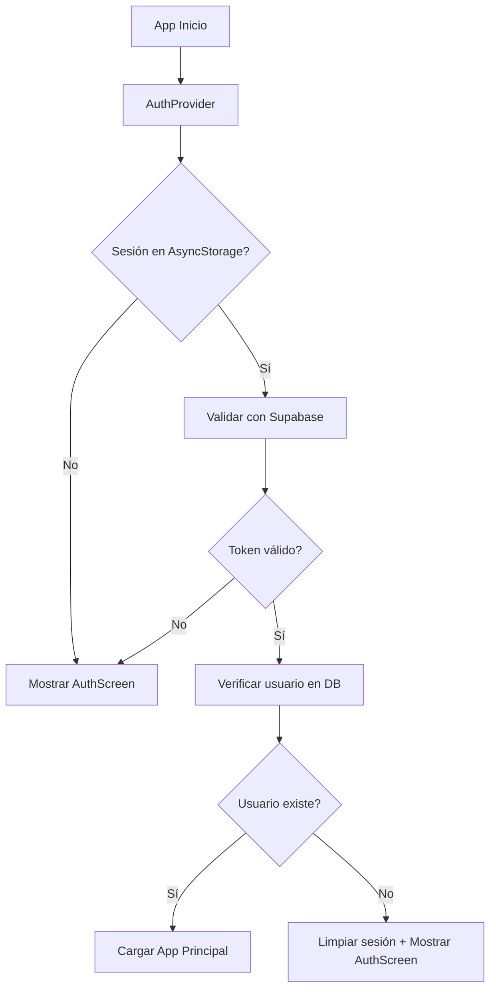

# Módulo de Autenticación - Documentación Técnica

## Índice

1. [Arquitectura](#arquitectura)
2. [Componentes y Pantallas](#componentes-y-pantallas)
3. [Contexto y Hooks](#contexto-y-hooks)
4. [Servicios y APIs](#servicios-y-apis)
5. [Base de Datos](#base-de-datos)
6. [Seguridad](#seguridad)
7. [Tipos TypeScript](#tipos-typescript)

---

## Arquitectura

### Stack Tecnológico

- **Autenticación**: Supabase Auth
- **Almacenamiento de Sesión**: AsyncStorage (React Native)
- **Gestión de Estado**: Context API + React Hooks
- **Navegación**: React Navigation con protección de rutas

### Flujo de Autenticación



---

## Componentes y Pantallas

**Archivo**: [`src/screens/auth/AuthScreen.tsx`](file:///Users/josep/Projectos/alzan/src/screens/auth/AuthScreen.tsx)

**Propósito**: Pantalla de inicio de sesión principal.

**Funciones Principales**:

- `handleLogin()`: Ejecuta login con `supabase.auth.signInWithPassword({ email, password })`
- `handleCreateAccount()`: Navega a `SignUpEmailScreen` para iniciar el flujo de registro.

**Navegación**:

- Éxito → Automático a `HomeScreen` (manejado por `RootNavigator`)
- "Olvidé contraseña" → `ForgotPasswordScreen`

---

### 1.1. SignUp Screens

**SignUpEmailScreen**: [`src/screens/auth/SignUpEmailScreen.tsx`](file:///Users/josep/Projectos/alzan/src/screens/auth/SignUpEmailScreen.tsx)

- Captura de email y validación inicial.

**SignUpPasswordScreen**: [`src/screens/auth/SignUpPasswordScreen.tsx`](file:///Users/josep/Projectos/alzan/src/screens/auth/SignUpPasswordScreen.tsx)

- Registro final usando `supabase.auth.signUp({ email, password })`.

---

### 1.5. VerifyEmailScreen

**Archivo**: [`src/screens/auth/VerifyEmailScreen.tsx`](file:///Users/josep/Projectos/alzan/src/screens/auth/VerifyEmailScreen.tsx)

**Propósito**: Pantalla intermedia para usuarios que se han registrado pero no han confirmado su email.

- Muestra instrucciones
- Permite reenviar correo
- Detecta confirmación automáticamente (polling o deep link)

---

### 2. ForgotPasswordScreen

**Archivo**: [`src/screens/auth/ForgotPasswordScreen.tsx`](file:///Users/josep/Projectos/alzan/src/screens/auth/ForgotPasswordScreen.tsx)

**Propósito**: Recuperación de contraseña vía email.

**Implementación**:

```typescript
const handleResetPassword = async () => {
  const websiteUrl = process.env.EXPO_PUBLIC_WEBSITE_URL || 'https://alzanhealth.com';
  const { error } = await supabase.auth.resetPasswordForEmail(email, {
    redirectTo: `${websiteUrl}/reset-password`,
  });

  if (!error) {
    Alert.alert('Éxito', 'Revisa tu email para restablecer la contraseña');
  }
};
```

**Redirección**: Web externa (configurada vía `EXPO_PUBLIC_WEBSITE_URL`)

---

### 2.1. ResetPasswordScreen

**Archivo**: [`src/screens/auth/ResetPasswordScreen.tsx`](file:///Users/josep/Projectos/alzan/src/screens/auth/ResetPasswordScreen.tsx)

**Propósito**: Permite al usuario establecer una nueva contraseña tras recibir el email de recuperación.

- Validaciones de seguridad de contraseña.
- Uso de `supabase.auth.updateUser({ password })`.

---

### 4. Onboarding Screens

**Ubicación**: `src/screens/onboarding/`
**Módulo Dedicado**: Consultar [`onboarding_module.md`](./onboarding_module.md)

El proceso de registro continúa con un flujo de onboarding granular gestionado por `OnboardingNavigator`.

**Principales Pantallas**:

- `OnboardingGoal.tsx`: Definición de objetivos primarios.
- `OnboardingProfile.tsx`: Datos biográficos (edad, sexo).
- `OnboardingPhysical.tsx`: Antropometría (altura, peso).
- `OnboardingComplete.tsx`: Finalización del flujo.

**Validaciones**:

- Altura: 100-250 cm
- Peso: 20-300 kg
- Edad: Calculada desde `date_of_birth`, debe ser >= 13 años

**Persistencia**:

```typescript
await supabase.from('profiles').update(profileData).eq('id', user.id);
```

**Navegación**: → `HomeScreen` (completa onboarding)

---

## Contexto y Hooks

### AuthContext

**Archivo**: [`src/context/AuthContext.tsx`](file:///Users/josep/Projectos/alzan/src/context/AuthContext.tsx)

**Interfaz**:

```typescript
interface AuthContextType {
  session: Session | null;
  user: User | null;
  loading: boolean;
  signOut: () => Promise<void>;
}
```

**Lógica de Inicialización**:

1. **Obtener sesión de AsyncStorage** vía `supabase.auth.getSession()`
2. **Validar token** con Supabase
3. **Verificar existencia en DB**:
   ```typescript
   const { data: userExists } = await supabase.from('users').select('id').eq('id', session.user.id).maybeSingle();
   ```
4. **Si usuario no existe en DB** → Forzar logout y limpiar AsyncStorage
5. **Si válido** → Establecer sesión

**Listener de Cambios**:

```typescript
supabase.auth.onAuthStateChange(async (_event, session) => {
  setSession(session);
});
```

**Eventos Manejados**:

- `SIGNED_IN`: Usuario inicia sesión
- `SIGNED_OUT`: Usuario cierra sesión
- `TOKEN_REFRESHED`: Token renovado automáticamente
- `USER_UPDATED`: Datos de usuario actualizados

---

### useAuth Hook

**Uso**:

```typescript
const { user, session, loading, signOut } = useAuth();

// Verificar autenticación
if (!user) {
  return <AuthScreen />;
}

// Cerrar sesión
await signOut();
```

---

## Servicios y APIs

### Supabase Auth API

#### Login

```typescript
const { data, error } = await supabase.auth.signInWithPassword({
  email: 'user@example.com',
  password: 'password123',
});
```

#### Registro

```typescript
const { data, error } = await supabase.auth.signUp({
  email: 'user@example.com',
  password: 'password123',
});
```

#### Recuperación de Contraseña

```typescript
const { error } = await supabase.auth.resetPasswordForEmail(email, {
  redirectTo: `${process.env.EXPO_PUBLIC_WEBSITE_URL}/reset-password`,
});
```

#### Logout

```typescript
await supabase.auth.signOut();
await AsyncStorage.clear(); // Limpieza adicional
```

#### Obtener Sesión Actual

```typescript
const {
  data: { session },
} = await supabase.auth.getSession();
```

---

## Base de Datos

### Tabla: `users`

Tabla de autenticación de Supabase (esquema `auth`).

```sql
-- Gestionada automáticamente por Supabase Auth
-- Campos principales:
id UUID PRIMARY KEY
email TEXT UNIQUE NOT NULL
encrypted_password TEXT
email_confirmed_at TIMESTAMPTZ
created_at TIMESTAMPTZ
updated_at TIMESTAMPTZ
```

### Tabla: `profiles`

Perfil extendido del usuario (esquema `public`).

```sql
CREATE TABLE profiles (
  id UUID PRIMARY KEY REFERENCES auth.users(id) ON DELETE CASCADE,
  email TEXT,
  full_name TEXT,
  sex TEXT CHECK (sex IN ('male', 'female')),
  date_of_birth DATE,
  height_cm DECIMAL(5,2),
  weight_kg DECIMAL(5,2),
  activity_level TEXT,
  created_at TIMESTAMPTZ DEFAULT NOW(),
  updated_at TIMESTAMPTZ DEFAULT NOW()
);
```

**Trigger de Creación Automática**:

```sql
CREATE FUNCTION public.handle_new_user()
RETURNS TRIGGER AS $$
BEGIN
  INSERT INTO public.profiles (id, email)
  VALUES (NEW.id, NEW.email);
  RETURN NEW;
END;
$$ LANGUAGE plpgsql SECURITY DEFINER;

CREATE TRIGGER on_auth_user_created
  AFTER INSERT ON auth.users
  FOR EACH ROW EXECUTE FUNCTION public.handle_new_user();
```

### Tabla: `user_preferences`

Preferencias y objetivos del usuario.

```sql
CREATE TABLE user_preferences (
  id UUID PRIMARY KEY DEFAULT uuid_generate_v4(),
  user_id UUID REFERENCES auth.users(id) ON DELETE CASCADE,
  primary_goal TEXT CHECK (primary_goal IN ('lose_weight', 'build_muscle', 'improve_endurance', 'keep_fit')),
  import_health_metrics BOOLEAN DEFAULT FALSE,
  created_at TIMESTAMPTZ DEFAULT NOW(),
  updated_at TIMESTAMPTZ DEFAULT NOW(),
  UNIQUE(user_id)
);
```

---

## Seguridad

### Row Level Security (RLS)

#### Políticas para `profiles`

```sql
-- Usuarios solo pueden ver su propio perfil
CREATE POLICY "Users can view own profile"
  ON profiles FOR SELECT
  USING (auth.uid() = id);

-- Usuarios solo pueden actualizar su propio perfil
CREATE POLICY "Users can update own profile"
  ON profiles FOR UPDATE
  USING (auth.uid() = id);
```

#### Políticas para `user_preferences`

```sql
CREATE POLICY "Users can manage own preferences"
  ON user_preferences FOR ALL
  USING (auth.uid() = user_id);
```

### Validación de Email

- Supabase envía email de confirmación automáticamente
- Usuario debe confirmar email antes de acceder (configurable)

### Seguridad de Contraseñas

- Mínimo 6 caracteres (configurable en Supabase Dashboard)
- Hasheadas con bcrypt
- Nunca almacenadas en texto plano

### Tokens JWT

- **Access Token**: Válido por 1 hora (configurable)
- **Refresh Token**: Válido por 30 días
- Renovación automática manejada por Supabase SDK

---

## Tipos TypeScript

### Auth Types

```typescript
import { Session, User } from '@supabase/supabase-js';

interface AuthContextType {
  session: Session | null;
  user: User | null;
  loading: boolean;
  signOut: () => Promise<void>;
}

interface Profile {
  id: string;
  email: string;
  full_name?: string;
  sex?: 'male' | 'female';
  date_of_birth?: string;
  height_cm?: number;
  weight_kg?: number;
  activity_level?: 'sedentary' | 'light' | 'moderate' | 'active' | 'very_active';
  created_at: string;
  updated_at: string;
}

interface UserPreferences {
  id: string;
  user_id: string;
  primary_goal?: 'lose_weight' | 'build_muscle' | 'improve_endurance' | 'keep_fit';
  import_health_metrics: boolean;
  created_at: string;
  updated_at: string;
}
```

---

## Manejo de Errores

### Errores Comunes

#### Error: "Invalid login credentials"

```typescript
if (error?.message === 'Invalid login credentials') {
  Alert.alert('Error', 'Email o contraseña incorrectos');
}
```

#### Error: "User already registered"

```typescript
if (error?.message?.includes('already registered')) {
  Alert.alert('Error', 'Este email ya está registrado');
}
```

#### Error: "Email not confirmed"

```typescript
if (error?.message?.includes('Email not confirmed')) {
  Alert.alert('Error', 'Por favor confirma tu email antes de iniciar sesión');
}
```

### Estrategia de Retry

- **Token expirado**: Renovación automática vía Supabase SDK
- **Sin conexión**: Mostrar mensaje y permitir retry manual
- **Sesión corrupta**: Limpiar AsyncStorage y forzar re-login

---

## Navegación Condicional

### RootNavigator

**Archivo**: [`src/navigation/RootNavigator.tsx`](file:///Users/josep/Projectos/alzan/src/navigation/RootNavigator.tsx)

```typescript
const RootNavigator = () => {
  const { user, loading } = useAuth();

  if (loading) {
    return <LoadingScreen />;
  }

  return (
    <NavigationContainer>
      {user ? <MainTabNavigator /> : <AuthStack />}
    </NavigationContainer>
  );
};
```

**Lógica**:

- `loading === true` → Mostrar splash/loading
- `user === null` → Mostrar stack de autenticación
- `user !== null` → Mostrar app principal

---

## Configuración

### Deep Links (app.json)

```json
{
  "expo": {
    "scheme": "alzan",
    "ios": {
      "associatedDomains": ["applinks:alzan.app"]
    },
    "android": {
      "intentFilters": [
        {
          "action": "VIEW",
          "data": [
            {
              "scheme": "alzan"
            }
          ]
        }
      ]
    }
  }
}
```

### Supabase Configuration

**Archivo**: [`src/lib/supabaseClient.ts`](file:///Users/josep/Projectos/alzan/src/lib/supabaseClient.ts)

```typescript
import { createClient } from '@supabase/supabase-js';
import AsyncStorage from '@react-native-async-storage/async-storage';

const supabaseUrl = process.env.EXPO_PUBLIC_SUPABASE_URL!;
const supabaseAnonKey = process.env.EXPO_PUBLIC_SUPABASE_ANON_KEY!;

export const supabase = createClient(supabaseUrl, supabaseAnonKey, {
  auth: {
    storage: AsyncStorage,
    autoRefreshToken: true,
    persistSession: true,
    detectSessionInUrl: false,
  },
});
```

---

## Testing

### Casos de Prueba

#### Login Exitoso

```typescript
test('should login with valid credentials', async () => {
  const { data, error } = await supabase.auth.signInWithPassword({
    email: 'test@example.com',
    password: 'password123',
  });

  expect(error).toBeNull();
  expect(data.user).toBeDefined();
});
```

#### Login Fallido

```typescript
test('should fail with invalid credentials', async () => {
  const { error } = await supabase.auth.signInWithPassword({
    email: 'test@example.com',
    password: 'wrongpassword',
  });

  expect(error).toBeDefined();
  expect(error?.message).toContain('Invalid login credentials');
});
```

#### Persistencia de Sesión

```typescript
test('should persist session after app restart', async () => {
  // Simular cierre de app
  await AsyncStorage.clear();

  // Reabrir app
  const {
    data: { session },
  } = await supabase.auth.getSession();

  expect(session).toBeDefined();
});
```

---

## Mejoras Futuras

### Corto Plazo

- [ ] Implementar OAuth con Google (real)
- [ ] Implementar OAuth con Apple (real)
- [ ] Añadir autenticación biométrica (Face ID/Touch ID)
- [ ] Implementar 2FA (Two-Factor Authentication)

### Medio Plazo

- [ ] Login con número de teléfono (SMS)
- [ ] Soporte para múltiples sesiones
- [ ] Gestión de dispositivos conectados

### Largo Plazo

- [ ] SSO (Single Sign-On) empresarial
- [ ] Autenticación sin contraseña (Passkeys)
