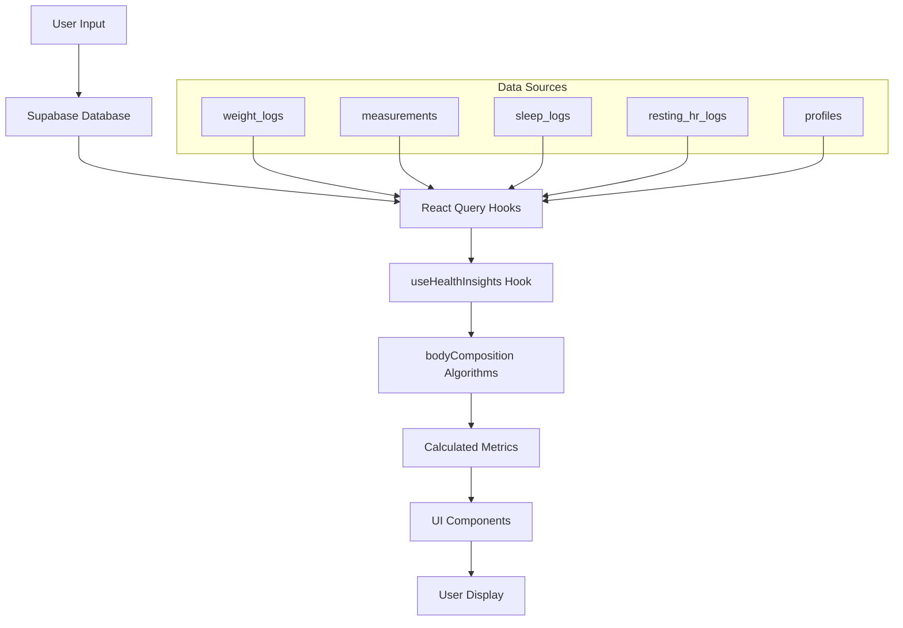

# Health Module - Technical Documentation

> **Version**: 2.0.0  
> **Last Updated**: 2025-12-10  
> **Module Path**: `src/modules/health/`

---

## Table of Contents

1. [Overview](#overview)
2. [Architecture](#architecture)
3. [Algorithms](#algorithms)
   - [BMI Calculation](#bmi-calculation)
   - [Body Fat Estimation](#body-fat-estimation)
   - [Muscle Mass Estimation](#muscle-mass-estimation)
4. [Data Flow](#data-flow)
5. [API Reference](#api-reference)
6. [Database Schema](#database-schema)
7. [UI Components](#ui-components)
8. [Testing](#testing)

---

## Overview

The Health Module is responsible for tracking, calculating, and displaying body composition metrics in the Alzan Health app. It provides users with insights into their:

- **BMI** (Body Mass Index)
- **Body Fat Percentage** (with basic and advanced estimation methods)
- **Muscle Mass** (skeletal muscle in kg and %)
- **Lean Mass / Fat Mass** breakdown
- **Weight trends** over time

### Key Features

- ✅ Multi-level precision algorithms (basic vs. advanced)
- ✅ Smart scale integration support
- ✅ Anthropometric measurement support
- ✅ Sex-specific calculation adjustments
- ✅ Age-adjusted estimations
- ✅ Historical tracking and charts

---

## Architecture

```
src/modules/health/
├── algorithms/           # Pure calculation functions
│   └── bodyComposition.ts
├── components/           # Reusable UI components
│   ├── RangeBar.tsx
│   ├── HealthInteractiveChart.tsx
│   └── ...
├── hooks/               # React hooks for data fetching
│   ├── useHealthInsights.ts  # Main aggregator hook
│   ├── useWeight.ts
│   ├── useMeasurements.ts
│   ├── useSleep.ts
│   └── useRestingHR.ts
├── screens/             # UI screens
│   ├── BodyCompositionDetail.tsx
│   ├── WeightLogScreen.tsx
│   └── ...
└── services/            # API/Database services
    ├── weightApi.ts
    ├── measurementApi.ts
    └── ...
```

### Design Principles

1. **Separation of Concerns**: Algorithms are pure functions, UI is separate
2. **Progressive Enhancement**: Data availability determines precision level
3. **Reactive Data Flow**: React Query for data fetching, automatic updates
4. **Type Safety**: Full TypeScript coverage with exported interfaces

---

## Algorithms

### BMI Calculation

**File**: `algorithms/bodyComposition.ts`  
**Function**: `calculateBMI(weightKg, heightCm)`

#### Formula

```
BMI = weight (kg) / height (m)²
```

#### Categories (WHO Standards)

| Category    | BMI Range   |
| ----------- | ----------- |
| Underweight | < 18.5      |
| Normal      | 18.5 - 24.9 |
| Overweight  | 25.0 - 29.9 |
| Obese       | ≥ 30.0      |

#### Usage Example

```typescript
import { calculateBMI } from '../algorithms/bodyComposition';

const result = calculateBMI(70, 175);
// result = { bmi: 22.9, category: 'normal' }
```

---

### Body Fat Estimation

**Function**: `estimateBodyFat(weightKg, heightCm, age, sex, measurements?, loggedBodyFat?)`

#### Priority Order

1. **Direct Measurement** (from smart scale or manual input)
2. **Level 2**: Advanced estimation with anthropometric data
3. **Level 1**: Basic Deurenberg formula

#### Level 1 - Deurenberg Formula

```
BF% = 1.20 × BMI + 0.23 × age - 10.8 × sex - 5.4
```

Where `sex` = 1 for male, 0 for female

#### Level 2 - Advanced Adjustments

| Adjustment      | Formula                                | Purpose                   |
| --------------- | -------------------------------------- | ------------------------- |
| **BAI**         | `(hip_m / height_m^1.5) - 18`          | Hip-based adiposity index |
| **WHtR**        | `abdomen / height × adjustment_factor` | Waist-to-height ratio     |
| **Muscularity** | `avg_circumference / height`           | Muscle mass correction    |

#### Body Fat Categories (Sex-Specific)

**Male**
| Category | Range |
|------------|----------|
| Low | < 6% |
| Lean | 6 - 12% |
| Standard | 13 - 19% |
| High | 20 - 24% |
| Very High | ≥ 25% |

**Female**
| Category | Range |
|------------|----------|
| Low | < 16% |
| Lean | 16 - 22% |
| Standard | 23 - 29% |
| High | 30 - 35% |
| Very High | ≥ 36% |

---

### Muscle Mass Estimation

**Function**: `estimateMuscleMass(weightKg, heightCm, age, sex, bodyFatPercent, measurements?)`

#### Calculation Process

1. Calculate fat mass: `fatMass = weight × (bodyFat% / 100)`
2. Calculate lean mass: `leanMass = weight - fatMass`
3. Apply base muscle fraction:
   - Male: 52% of lean mass
   - Female: 48% of lean mass
4. Apply age adjustment: `-0.2% per year over 30`
5. [Level 2] Apply muscularity index adjustment

#### Muscularity Index

```
MI = average_muscle_circumference / height
```

Neutral values:

- Male: 0.55
- Female: 0.50

Deviation from neutral adjusts the muscle fraction estimate.

---

## Data Flow



### Hook Dependencies

```typescript
// useHealthInsights aggregates:
const { data: weightLogs } = useWeightLogs();
const { data: measurements } = useMeasurements();
const { data: sleepLogs } = useSleepLogs();
const { data: hrLogs } = useRestingHRLogs();
const { data: profile } = useUserProfile();
```

---

## API Reference

### Types

```typescript
// BMI
type BmiCategory = 'underweight' | 'normal' | 'overweight' | 'obese';

interface BmiResult {
  bmi: number;
  category: BmiCategory;
}

// Body Fat
type BodyFatCategory = 'low' | 'lean' | 'standard' | 'high' | 'very_high';

interface BodyFatResult {
  percentage: number;
  category: BodyFatCategory;
  method: 'measured' | 'bmi+age+sex' | 'bmi+age+sex+extraAnthropometry';
  methodLabel: string;
  precisionLevel: 1 | 2;
}

// Muscle
interface MuscleResult {
  percentage: number;
  massKg: number;
  method: 'basic' | 'advanced';
  precisionLevel: 1 | 2;
}

// Anthropometric Measurements
interface AnthroMeasurements {
  hip?: number;
  abdomen?: number;
  chest?: number;
  arm?: number;
  thigh?: number;
}
```

### Functions

| Function                  | Parameters                                                    | Returns                 | Description                     |
| ------------------------- | ------------------------------------------------------------- | ----------------------- | ------------------------------- |
| `calculateBMI`            | `weightKg, heightCm`                                          | `BmiResult`             | WHO BMI calculation             |
| `estimateBodyFat`         | `weightKg, heightCm, age, sex, measurements?, loggedBodyFat?` | `BodyFatResult \| null` | Multi-level body fat estimation |
| `estimateMuscleMass`      | `weightKg, heightCm, age, sex, bodyFatPercent, measurements?` | `MuscleResult \| null`  | Skeletal muscle estimation      |
| `hasEnoughDataForBmi`     | `weightKg?, heightCm?`                                        | `boolean`               | Data sufficiency check          |
| `hasEnoughDataForBodyFat` | `weightKg?, heightCm?, age?, sex?, hipCm?, loggedBodyFat?`    | `boolean`               | Data sufficiency check          |

---

## Database Schema

### weight_logs

```sql
CREATE TABLE weight_logs (
    id UUID PRIMARY KEY,
    user_id UUID REFERENCES auth.users(id),
    weight_kg DECIMAL(5,2) NOT NULL,
    bodyfat_percent DECIMAL(4,1),  -- From smart scale
    muscle_mass_kg DECIMAL(5,2),   -- From smart scale
    measured_at TIMESTAMPTZ DEFAULT NOW(),
    created_at TIMESTAMPTZ DEFAULT NOW()
);
```

### measurements

```sql
CREATE TABLE measurements (
    id UUID PRIMARY KEY,
    user_id UUID REFERENCES auth.users(id),
    measurement_type TEXT NOT NULL,  -- 'abdomen', 'hip', 'chest', 'arm', 'thigh'
    value_cm DECIMAL(5,1) NOT NULL,
    measured_at TIMESTAMPTZ DEFAULT NOW()
);
```

### profiles (relevant fields)

```sql
-- Relevant health fields in profiles table
height_cm DECIMAL(5,1),
date_of_birth DATE,
sex TEXT  -- 'male', 'female', 'other', 'prefer_not-to-say'
```

---

## UI Components

### BodyCompositionDetail

**Path**: `screens/BodyCompositionDetail.tsx`

Main screen displaying all body composition metrics with:

- Interactive MetricCards for BMI, Body Fat, Muscle
- RangeBar visualizations with segment colors
- Bottom Sheet info modals with calculation explanations
- Dynamic tips based on data availability
- Mass distribution summary (muscle/fat/lean kg)

### RangeBar

**Path**: `components/RangeBar.tsx`

Configurable visualization component for numeric ranges:

```typescript
<RangeBar
    value={22.5}
    min={15}
    max={35}
    segments={[
        { to: 18.5, color: '#3B82F6', label: 'Bajo' },
        { to: 25, color: '#10B981', label: 'Normal' },
        { to: 30, color: '#F59E0B', label: 'Sobre' },
        { to: 35, color: '#EF4444', label: 'Obeso' },
    ]}
    showCutoffs={true}  // Show numeric values above bar
    hideLegend={false}  // Show labels below segments
/>
```

### HealthInteractiveChart

**Path**: `components/HealthInteractiveChart.tsx`

Historical trend chart supporting multiple metrics:

- Weight
- BMI
- Body Fat %
- Muscle Mass (kg)
- Anthropometric measurements

---

## Testing

### Unit Test Coverage

```bash
# Run health module tests
npm test -- --testPathPattern="health"
```

### Manual Verification Checklist

- [ ] BMI calculation with edge cases (very low/high BMI)
- [ ] Body Fat Level 1 vs Level 2 switching
- [ ] Muscle mass with/without circumference data
- [ ] Age adjustment under/over 30
- [ ] Sex-specific category thresholds
- [ ] Historical chart data aggregation
- [ ] Info modal tips (dynamic based on available data)

### Test Data Examples

```typescript
// Basic user (Level 1)
const basicUser = {
  weight: 75,
  height: 175,
  age: 32,
  sex: 'male',
};
// Expected: BMI ~24.5, BF% ~23 (Deurenberg), Muscle ~30kg

// Advanced user (Level 2)
const advancedUser = {
  ...basicUser,
  abdomen: 82,
  hip: 98,
  chest: 102,
  arm: 35,
  thigh: 56,
};
// Expected: BF% adjusted based on circumferences, Muscle adjusted by MI
```

---

## Debugging

### Enable Debug Logs

All modules support debug logging via the `DEBUG` constant:

```typescript
// In bodyComposition.ts and useHealthInsights.ts
const DEBUG = __DEV__ || false;
```

When enabled, logs will appear in the console with context prefixes:

- `[BodyComposition:calculateBMI]`
- `[BodyComposition:estimateBodyFat]`
- `[useHealthInsights]`

### Common Issues

| Issue               | Cause                           | Solution                       |
| ------------------- | ------------------------------- | ------------------------------ |
| Body fat shows null | Missing age or sex in profile   | Ensure profile is complete     |
| Muscle uses Level 1 | No chest/arm/thigh measurements | Add circumference measurements |
| BMI shows '--'      | Missing weight or height        | Check weight_logs and profile  |
| Charts empty        | No historical data              | Add more data points over time |

---

## References

1. Deurenberg P, Weststrate JA, Seidell JC. "Body mass index as a measure of body fatness: age- and sex-specific prediction formulas." Br J Nutr. 1991.
2. Bergman RN, et al. "A better index of body adiposity." Obesity. 2011.
3. Ashwell M, Hsieh SD. "Six reasons why the waist-to-height ratio is a rapid and effective global indicator for health risks of obesity." Int J Food Sci Nutr. 2005.
4. WHO. "Body mass index - BMI." World Health Organization.

---

_Documentation generated for Alzan Health Module v2.0.0_
