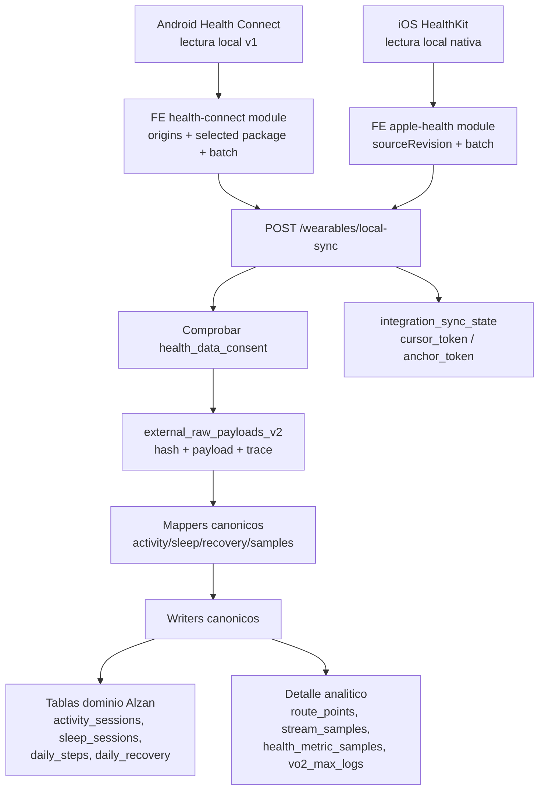
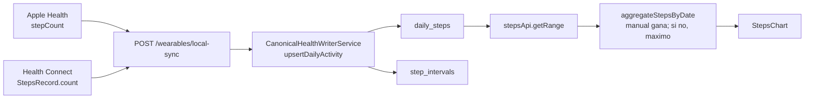

# Dashboard de Implementacion Wearables

Este dashboard resume los cambios implementados para la integracion de wearables en Alzan Health. Esta pensado para producto, backend, mobile y datos: permite ver de un vistazo que existe ya, que queda pendiente y donde tocar codigo.

## Estado Ejecutivo

| Area              | Estado   | Que significa                                                                                                                                                                   |
| ----------------- | -------- | ------------------------------------------------------------------------------------------------------------------------------------------------------------------------------- |
| Base de datos     | Hecho    | Hay migraciones para provenance, raw payloads, sync state, origins, rutas, streams, health samples y VO2 max.                                                                   |
| Backend wearables | Hecho    | Existe modulo NestJS `/wearables` con endpoints y servicios de importacion local.                                                                                               |
| Health Connect    | Hecho v1 | Existe modulo nativo Android `AlzanHealthConnect`, backend exige `source_package`, seleccion unica y lectura filtrada por `DataOrigin`.                                         |
| Apple HealthKit   | Hecho v1 | Existe modulo nativo iOS `AlzanAppleHealth` con HealthKit read-only, permisos, workouts, sleep, biomarcadores, peso/body fat y rutas. Requiere iPhone fisico para datos reales. |
| Pantalla Pasos    | Hecho v1 | La pantalla lee `daily_steps`; Apple Health y Health Connect la alimentan. Garmin/Suunto no deben mostrarse como pasos diarios cloud todavia.                                  |
| Polar             | Hecho v1 | OAuth callback publico, registro AccessLink y sync manual de `/v3/exercises` hacia el writer canonico.                                                                          |
| Cloud providers   | Parcial  | Polar ya tiene pull manual. El resto sigue preparado por OAuth/provenance, pero sin jobs/webhooks/backfills.                                                                    |
| Frontend contrato | Mejorado | Settings permite conectar/sincronizar Apple Health, Health Connect y Polar; Apple usa modulo nativo propio y Polar usa endpoint cloud.                                          |
| Seguridad         | Mejorada | Tokens nuevos pasan a tabla privada; raw payloads no tienen policy cliente. Falta cifrado fuerte/Vault.                                                                         |
| Verificacion      | Parcial  | Backend, formato, imports wearables y build Android pasan. Frontend `typecheck`/lint global siguen bloqueados por tipado Supabase general.                                      |

## Mapa Rapido de Cambios

| Bloque                    | Archivos principales                                                               | Responsabilidad                                                                                |
| ------------------------- | ---------------------------------------------------------------------------------- | ---------------------------------------------------------------------------------------------- |
| Migraciones fase 1        | `supabase/migrations/20260513100000_wearables_phase1_provenance_sync.sql`          | Provenance, origins, seleccion Health Connect, sync state, raw payload v2, tokens privados.    |
| Migraciones fase 2        | `supabase/migrations/20260513101000_wearables_phase2_activity_detail.sql`          | Route points, stream samples, provider fields, activity files.                                 |
| Migraciones fase 3        | `supabase/migrations/20260513102000_wearables_phase3_health_metrics.sql`           | Health metric samples y VO2 max historico.                                                     |
| Migraciones fase 4        | `supabase/migrations/20260513103000_wearables_phase4_indexes.sql`                  | Indices para consultas, dedupe y rendimiento.                                                  |
| Modulo backend            | `alzan-be/src/components/wearables/`                                               | API, DTOs, tipos, services y writers canonicos.                                                |
| Mappers existentes        | `alzan-be/src/components/activity-import/parsers/*health*`                         | Preservar provenance Apple Health y Health Connect.                                            |
| OAuth                     | `alzan-be/src/components/providers/oauth/base-oauth.provider.ts`                   | Guardar secretos en `provider_connection_tokens` en lugar de exponerlos en `user_connections`. |
| Swagger                   | `alzan-be/src/core/swagger/*`                                                      | Nuevo grupo/API de Wearables.                                                                  |
| Frontend local sync       | `alzan-fe/src/modules/wearables/`                                                  | Cliente HTTP autenticado para `/wearables`.                                                    |
| Frontend Health Connect   | `alzan-fe/src/modules/health-connect/`                                             | Helpers para origins, seleccion y batches Android.                                             |
| Frontend Apple Health     | `alzan-fe/src/modules/apple-health/`                                               | Helpers para batches iOS.                                                                      |
| Motor nativo Apple Health | `alzan-fe/plugins/withAlzanAppleHealth.js`, `alzan-fe/plugins/alzan-apple-health/` | Config plugin Expo y plantillas Swift/Obj-C versionadas para HealthKit.                        |
| UI settings               | `alzan-fe/src/screens/settings/ConnectedAppsScreen.tsx`                            | Cambia Google Fit por Health Connect como integracion futura correcta.                         |
| Documentacion             | `docs/wearables-integration.md`                                                    | Contrato tecnico detallado.                                                                    |

## Arquitectura Actual



La idea importante: Apple Health y Health Connect no son OAuth cloud. Son canales locales. El proveedor real de Android se identifica con `metadata.dataOrigin.packageName`, guardado como `source_package`.

## Pantalla Pasos

La pantalla `Pasos` no lee pasos desde actividades deportivas. Su fuente visual de verdad es `daily_steps`.

Flujo actual:



Reglas actuales:

- `activity_sessions.total_steps` puede guardar pasos dentro de un entrenamiento, pero no alimenta la pantalla `Pasos`.
- Si hay varias fuentes para una fecha, la app no las suma. La fila manual gana; si no existe manual, se muestra el mayor total de proveedor.
- Apple Health y Health Connect son los unicos canales que alimentan `daily_steps` de forma productiva hoy.
- Garmin tiene OAuth y mapper de daily activity, pero no tiene `GarminCloudSyncService` ni endpoint de daily summaries.
- Suunto tiene sync de workouts/FIT; esos pasos son de entrenamientos y no equivalen a pasos diarios en `daily_steps`.

Auditoria ejecutable:

```sh
pnpm verify:steps-providers
```

La matriz vive en `alzan-be/src/components/wearables/services/provider-steps-audit.ts` y falla si se marca un proveedor como listo para la pantalla sin escribir `daily_steps`.

## Base de Datos

### Tablas nuevas

| Tabla                               | Para que sirve                                                                              |
| ----------------------------------- | ------------------------------------------------------------------------------------------- |
| `provider_data_origins`             | Guarda origenes detectados, por ejemplo `com.fitbit.FitbitMobile` dentro de Health Connect. |
| `health_connect_provider_selection` | Guarda el unico origin seleccionado por usuario en Android.                                 |
| `integration_sync_state`            | Guarda cursores, change tokens y anchors por usuario, provider, canal, package y dominio.   |
| `external_raw_payloads_v2`          | Raw payload generico para actividades, sleep, recovery, daily, body y samples.              |
| `provider_connection_tokens`        | Tabla privada para access/refresh tokens OAuth.                                             |
| `activity_route_points`             | GPS punto a punto con timestamp, offset, altitud y accuracy.                                |
| `activity_stream_samples`           | Streams normalizados consultables por tiempo u offset.                                      |
| `activity_provider_fields`          | Campos especificos del proveedor, eventos, segmentos y fingerprints.                        |
| `activity_files`                    | Referencias a FIT/TCX/GPX/JSON/XML o payloads asociados.                                    |
| `health_metric_samples`             | Biomarcadores 24/7: HRV, SpO2, respiracion, temperatura, peso, VO2, resting HR.             |
| `vo2_max_logs`                      | Historico puntual de VO2 max.                                                               |

### Tablas existentes extendidas

Se agrego provenance nullable a tablas de dominio, por ejemplo:

- `source_channel`
- `source_package`
- `source_provider_key`
- `source_record_id`
- `source_updated_at`
- `raw_payload_id`

Esto permite responder siempre: de donde vino este dato, con que identificador externo, desde que paquete Android o bundle iOS, y que raw payload lo genero.

## Backend Wearables

| Servicio                         | Responsabilidad                                                                           |
| -------------------------------- | ----------------------------------------------------------------------------------------- |
| `RawPayloadService`              | Hash y almacenamiento del payload antes de normalizar.                                    |
| `ProviderOriginService`          | Alta/listado de origins y seleccion unica de Health Connect.                              |
| `IntegrationSyncStateService`    | Persistencia de tokens, anchors y estado de sync.                                         |
| `CanonicalActivityWriterService` | Upsert de workouts, laps, zones, streams, samples, route points y provider fields.        |
| `CanonicalHealthWriterService`   | Upsert de daily steps, sleep, stages, recovery, health samples, VO2, weight y resting HR. |
| `DedupeService`                  | Identidad fuerte y fingerprints para futuras agrupaciones cross-provider.                 |
| `LocalHealthSyncService`         | Orquestador de batches Apple Health/Health Connect.                                       |

### Endpoints nuevos

| Endpoint                                        | Uso                                                    |
| ----------------------------------------------- | ------------------------------------------------------ |
| `GET /wearables/health-connect/origins`         | Listar origins Android ya detectados.                  |
| `POST /wearables/health-connect/origins`        | Registrar origins detectados desde Health Connect.     |
| `POST /wearables/health-connect/origins/select` | Seleccionar el unico origin permitido para importar.   |
| `GET /wearables/health-connect/selection`       | Leer la seleccion actual.                              |
| `POST /wearables/local-sync`                    | Subir batch local desde Apple Health o Health Connect. |

Reglas aplicadas:

- Todos los endpoints requieren auth Supabase.
- Local sync exige `user_preferences.health_data_consent = true`.
- Health Connect exige `source_package`.
- Health Connect compara el package del batch/record con la seleccion guardada.
- Raw payload se guarda antes de escribir las tablas de dominio.

## Health Connect

Flujo esperado en Android:

1. Leer records permitidos desde Health Connect.
2. Agrupar origins por `record.metadata.dataOrigin.packageName`.
3. Enviar origins a `POST /wearables/health-connect/origins`.
4. El usuario elige uno.
5. Guardar seleccion con `POST /wearables/health-connect/origins/select`.
6. Leer records filtrando por ese `DataOrigin`.
7. Subir batches a `POST /wearables/local-sync`.
8. Guardar change tokens en `integration_sync_state`.

Estado actual: el backend impone la regla y el modulo nativo Android propio lee solo el origin seleccionado mediante `DataOrigin`. La cobertura v1 incluye steps, heart rate, exercise sessions, sleep sessions, resting heart rate, HRV RMSSD y weight. Quedan fuera de v1 rutas, laps, speed, power, cadence, distance summaries, calories, VO2 max, SpO2, respiratory rate, temperature y body fat.

## Apple HealthKit

Flujo esperado en iOS:

1. Pedir permisos de lectura.
2. Leer `HKWorkout`, samples, sleep analysis, biomarcadores, rutas y body metrics.
3. Enviar `uuid`, `sourceRevision`, `device` y `metadata`.
4. Subir batches a `POST /wearables/local-sync`.
5. Guardar anchors de `HKAnchoredObjectQuery` en `integration_sync_state`.

Estado actual: el backend, el cliente TypeScript y el puente nativo iOS aceptan batches Apple Health. El modulo nativo se instala mediante `withAlzanAppleHealth`, que copia Swift/Obj-C al proyecto iOS generado, enlaza HealthKit/CoreLocation y activa entitlement/usage description. Web no puede acceder a HealthKit; el simulador solo valida compilacion/permisos y los datos reales requieren iPhone fisico.

## Seguridad y Privacidad

| Riesgo                                      | Mitigacion implementada                                                                           |
| ------------------------------------------- | ------------------------------------------------------------------------------------------------- |
| Tokens OAuth visibles en `user_connections` | Nuevos tokens se guardan en `provider_connection_tokens`; `user_connections` queda como metadata. |
| Raw payloads accesibles desde cliente       | `external_raw_payloads_v2` tiene RLS activado sin policies de cliente.                            |
| Importar salud sin consentimiento           | `LocalHealthSyncService` exige `health_data_consent`.                                             |
| Mezclar fuentes Health Connect              | Seleccion unica por usuario y validacion de `source_package`.                                     |
| Perder trazabilidad                         | Provenance y `raw_payload_id` en tablas de dominio.                                               |
| Exponer GPS o biomarcadores socialmente     | Las tablas existen con RLS por usuario; la UI social debe mantener opt-in explicito.              |

Pendiente recomendado: cifrado fuerte de tokens con Vault/pgsodium o envelope encryption a nivel aplicacion.

## Verificacion Ejecutada

| Comando                                                                                           | Resultado                                                                          |
| ------------------------------------------------------------------------------------------------- | ---------------------------------------------------------------------------------- |
| `pnpm --prefix alzan-fe run format:check`                                                         | OK                                                                                 |
| `pnpm --prefix alzan-fe exec eslint src/hooks/usePolarConnection.ts src/modules/apple-health/...` | OK                                                                                 |
| `pnpm --prefix alzan-be run typecheck`                                                            | OK                                                                                 |
| `pnpm --prefix alzan-be run lint:check`                                                           | OK                                                                                 |
| `pnpm --prefix alzan-be run format:check`                                                         | OK                                                                                 |
| `pnpm run verify:activity-import`                                                                 | OK, 15/15 checks                                                                   |
| `pnpm verify:steps-providers`                                                                     | Verifica la matriz ejecutable de cobertura de pasos por proveedor.                 |
| `./gradlew :app:assembleDebug`                                                                    | OK                                                                                 |
| `pnpm --prefix alzan-fe run typecheck`                                                            | Bloqueado por errores Supabase generales, sobre todo en training y servicios.      |
| `pnpm --prefix alzan-fe run lint:check`                                                           | Bloqueado en frontend por 224 errores de tipado Supabase no limitados a wearables. |

## Lo Que No Esta Implementado Todavia

| Pendiente                                     | Motivo                                                                           |
| --------------------------------------------- | -------------------------------------------------------------------------------- |
| Cobertura avanzada Health Connect             | La v1 lee los records basicos; faltan rutas, laps y streams deportivos ricos.    |
| Delta sync HealthKit con anchors reales       | La v1 hace sync manual por ventana; falta `HKAnchoredObjectQuery` persistente.   |
| Jobs cloud por Garmin/Suunto/Polar/COROS/etc. | La base esta preparada, pero no se implementaron pulls/webhooks.                 |
| Procesamiento de deletes                      | Hay sync state y source ids, pero falta event processor por canal.               |
| Duplicate groups cross-provider               | Existe `DedupeService` inicial, pero no tablas de agrupacion finales.            |
| Cifrado fuerte de tokens                      | Se separaron tokens a tabla privada; falta Vault/encryption.                     |
| Regeneracion OpenAPI cliente                  | Swagger backend esta preparado, pero no se regenero cliente desde servidor vivo. |

## Como Explicarlo En Una Frase

Antes Alzan podia guardar actividades, sueño y salud, pero no tenia una capa completa para saber de donde venia cada dato ni sincronizarlo de forma segura. Ahora tiene una base de integracion: identifica origen real, guarda raw payload, deduplica por claves fuertes, mantiene cursores/anchors y escribe en las tablas actuales sin romper el schema.

## Siguiente Sprint Recomendado

1. Ejecutar migraciones en entorno de desarrollo Supabase.
2. Regenerar tipos desde Supabase real y OpenAPI desde backend corriendo.
3. Ampliar Health Connect v2 con rutas, laps y streams deportivos ricos.
4. Implementar HealthKit delta sync con anchored queries persistentes.
5. Añadir tests de endpoint `POST /wearables/local-sync` con batches Health Connect y Apple Health.
6. Implementar delete/update processors.
7. Añadir cifrado real de `provider_connection_tokens`.
8. Resolver el quality gate frontend global de tipos Supabase.

## Drift Map

| Feature                        | Docs                                            | Codigo                                                                       | Estado       |
| ------------------------------ | ----------------------------------------------- | ---------------------------------------------------------------------------- | ------------ |
| Wearables DB foundation        | `docs/wearables-integration.md`, este dashboard | `supabase/migrations/2026051310*.sql`                                        | Sincronizado |
| Backend local sync             | `docs/wearables-integration.md`, este dashboard | `alzan-be/src/components/wearables/`                                         | Sincronizado |
| Open Wearables reference       | No requerido                                    | Fue referencia historica; no queda como dependencia ni carpeta necesaria     | Retirado     |
| Polar AccessLink v1            | Este dashboard                                  | `PolarOAuthService`, `PolarAccessLinkService`, `CloudProviderSyncController` | Sincronizado |
| Health Connect selected origin | `docs/wearables-integration.md`, este dashboard | `ProviderOriginService`, `LocalHealthSyncService`                            | Sincronizado |
| Apple Health bridge contract   | `docs/wearables-integration.md`, este dashboard | `AlzanAppleHealth`, `appleHealthNative`, backend `/wearables/local-sync`     | Sincronizado |
| Native Health Connect filter   | Este dashboard                                  | `AlzanHealthConnectModule` filtra por `DataOrigin(selectedPackage)`          | Sincronizado |
| Cloud provider jobs            | Este dashboard                                  | Polar manual sync existe; jobs programados no existen aun                    | Parcial      |
